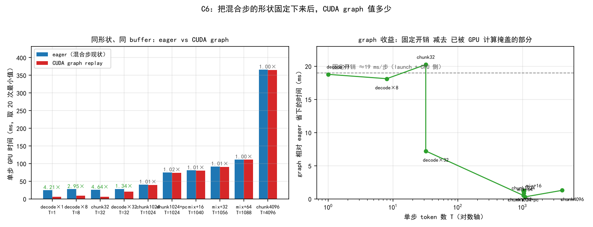

# CUDA 图 × 混合批：vLLM V1 的机制，与 nano-vllm 的优化路线

> **问题**：vLLM V1 让「混合批（prefill + decode 同批）」不必牺牲 CUDA graph 加速，它是怎么做到的？我该怎么做优化？
>
> **结论先说**：
> 1. **机制**不是一招，是四件事叠起来：统一扁平批 + 按 token 数分桶 padding + **在 attention 边界切图（piecewise）** + attention 出参化；配套 5 档 `CUDAGraphMode` 与运行时 dispatcher。**attention 之外的部分是 token-wise 的**，这才是能进图的根本原因。
> 2. **我们实测：整步是可以捕获的**。把形状固定下来后，唯一的阻塞是 `nanovllm/layers/embed_head.py:60` 那行 **bool 掩码索引**（`nonzero` 需要主机同步），换成捕获外预计算的静态 int64 gather 索引即可通过（C6b）。
> 3. **但收益只有 1%**（T≈1040~1088 的真实混合形状，省 0.3~1.3 ms/步）。原因是 graph 省的是**固定开销 ≈19 ms/步**，而 T≈1024 时 GPU 单步要 40~112 ms，launch 早被计算掩盖（C6）。
> 4. **所以不该抄 piecewise。** 该抄的是 **统一 attention 按 query 长度分组派发后端** —— C3 里混合步 decode 代价的 **74%（4.29 ms）**在这里，"没走 graph"只占 26%（1.48 ms）。
>
> 数据来源：`results/c6_prefill_graph.json`（`c6_prefill_graph.py`）、二分脚本 `c6b_bisect.py`、图 `figs/c6_prefill_graph.png`；对照分析见 `与vLLM官方口径对照.md` §2。

---

## 1. vLLM V1 的机制：为什么混合批还能吃 CUDA graph

### 1.1 四个前提

| # | 机制 | 为什么它是前提 |
| :--- | :--- | :--- |
| ① | **统一的扁平批表示** | V1 的批是"`{request_id: num_tokens}` + 张量化元数据（`query_start_loc` / `seq_lens` / `block_table` / `slot_mapping`）"。批内**没有** prefill 分支与 decode 分支，只有「总 token 数 T」这一个自由量。混合批因此退化成"形状由 T 决定的普通批"。 |
| ② | **按尺寸分桶 + padding** | `cudagraph_capture_sizes` / `max_cudagraph_capture_size`：预先录 {16,32,64,…,512} 等若干张图，实际批填到最近的桶，多出来的行用 dummy 掩盖。**形状静态化**是录图的第一步。 |
| ③ | **在 attention 边界切图（piecewise）** | 图**外**跑 attention（eager、形状自由），图**内**跑 attention 之间的一切。切分依据见下面的官方原话。 |
| ④ | **attention 出参化 + `cudagraph_unsafe` 标记** | ①让图拥有 buffer：attention 在图外跑，它的输出必须是一块图管理的静态 buffer，所以表现为"输出张量作为 attention 的入参"。②`torch._C.Tag.cudagraph_unsafe` + inductor graph partition 自动在 unsafe 算子处把 FX 图切成 N+1 段。 |

官方原文（[torch.compile integration](https://docs.vllm.ai/en/latest/design/torch_compile.html)）：

> 「…we only capture the cudagraph for the piece of graph between attention operations (including the first graph before any attention operation, and the last graph after all the attention operation). This is based on a common observation: **computation between attentions are usually token-wise and easy to deal with for cudagraph; while the attention operation is non-trivial to be cudagraph compatible.** Thus, by running the attention operation in eager mode while the rest operations in cudagraph, we keep the flexibility of the attention operation. … **This is why the attention operation in V1 has the output tensor as the input of the attention.**」

### 1.2 piecewise 落在一层 Transformer 上

```
        hidden [T, H]                      T = 本步总 token 数（已 pad 到桶）
   ┌──────────────────────────────────────────────┐
   │  段 i：RMSNorm → QKV GEMM → RoPE       ← CUDA Graph（形状只由 T 决定）
   └──────────────────────────────────────────────┘
                        ↓ q, k, v
   ┌──────────────────────────────────────────────┐
   │  vllm::unified_attention_with_output   ← eager（形状随每个请求的 seq_len 变）
   │  （内部写 paged KV cache + 调 FA3/FlashInfer）
   └──────────────────────────────────────────────┘
                        ↓ o（写进图拥有的静态 buffer）
   ┌──────────────────────────────────────────────┐
   │  段 i+1：O-proj → AllReduce → 残差 → MLP ← CUDA Graph（与下一层前半段合并）
   └──────────────────────────────────────────────┘
```

一个 80 层模型：一次 forward 约 **81 段图 replay + 80 次 eager attention**。绿段内 kernel 间没有 launch 气泡；橙色的 attention 因为形状不固定只能由 CPU 逐次发射，但它是每层最"胖"的 kernel，launch 开销相对可接受 —— 这就是 piecewise 的取舍。

### 1.3 五档 `CUDAGraphMode`（vLLM 现在的实际形态）

官方术语：**uniform decode batch** = `max_query_len == 1`；反之（prefill 或混合）叫 **non-uniform batch**。

| 模式 | 含义 | 适用 |
| :--- | :--- | :--- |
| `NONE` | 关图 | 调试 |
| `PIECEWISE` | attention 留图外，其余进图（**需要 piecewise 编译**） | 通用、最灵活 |
| `FULL` | **对非均匀批（prefill / 混合）也录整图**，同 batch_size 的纯 decode 批复用这同一张图 | 官方注明「good for **small models or workloads with small prompts**」 |
| `FULL_DECODE_ONLY` | 只给纯 decode 录整图，prefill/混合不录 | P/D 分离里的 decode 实例（省显存） |
| `FULL_AND_PIECEWISE` | **V1 默认**：纯 decode 走整图，prefill/混合走分段图 | 官方称通常最快，但最吃显存、捕获最慢 |

运行时由 **CUDA Graphs dispatcher** 按批组成自动选模式（双模式在成员模式间切换，无合适图时降级 `NONE`）。

两条官方边界：

- **只有 FA3 支持对非均匀批做 full cudagraph**（FlashInfer / FlashMLA / Mamba 等只支持"纯 decode 的整图"）；
- **cascade attention 不图安全**，用到它时一律降级到 `PIECEWISE`。

> 注意官方对 chunked prefill 的收益宣传里，**"减少 graph 开销"从来不是一条**。列表永远是：改善 ITL / 提高 GPU 利用率 / 平滑生成。这和我们 C6 的实测完全一致。

---

## 2. 我们这边的实测：能不能抄

### 2.1 C6b：阻塞点在哪（二分定位）

脚本 `c6b_bisect.py`，每个阶段独立进程（CUDA 的 sticky error 会污染上下文）：

| 阶段 | 结果 |
| :--- | :--- |
| `warm`（只预热 3 次，不捕获） | PASS（形状本身没问题） |
| `cap_model` —— 只捕获 28 层主干（**含** FA varlen + prefix cache 的 `block_table` 路径 + triton `store_kvcache`） | **PASS ×** |
| `cap_logits` —— 只捕获 lm_head，保持原样 | **FAIL** |
| `cap_logits` + 静态 gather 索引 | PASS |
| `full` —— 整步（主干 + lm_head），保持原样 | **FAIL** |
| `full` + 静态 gather 索引 | **PASS** ✓ |
| `full` + 静态索引 + `--no-attn` | PASS |
| `full` + 静态索引 + `--no-compile` | PASS |

打开 `CUDA_LAUNCH_BLOCKING=1` 拿到的**第一现场**：

```
File "nanovllm/layers/embed_head.py", line 60, in forward
    last_indices = last_indices[context.need_logits]
torch.AcceleratorError: CUDA error: operation not permitted when stream is capturing
```

**根因**：布尔掩码索引在 aten 里走 `nonzero`，需要一次 device→host 的计数同步，捕获流里非法。
**修法**：换成**捕获外预计算、形状固定的 1D `int64` gather 索引**（即 vLLM 的 `logits_indices` + pad 到桶）。`--no-attn` / `--no-compile` 都仍然失败、只有换索引才过 —— 说明**这是唯一的结构性阻塞**，与 attention、与 `torch.compile` 都无关。

> 值得记一笔：这行代码是用户自己那三项优化里「跳过采样（`need_logits`）」引入的。它同时是"混合步能不能进图"的唯一阻塞。

### 2.2 C6：修完之后值多少（10/10 形状全部捕获成功）

同形状、同 buffer、同输入拷贝，`min of 20`：

| 形状 | T | eager | graph | 省 | 倍数 |
| :--- | ---: | ---: | ---: | ---: | ---: |
| decode×1 | 1 | 24.63 ms | 5.85 ms | **18.78 ms** | **4.21×** |
| decode×8 | 8 | 27.43 | 9.30 | 18.12 | 2.95× |
| chunk32 | 32 | 25.81 | 5.56 | **20.25** | **4.64×** |
| decode×32 | 32 | 28.20 | 20.97 | 7.22 | 1.34× |
| chunk1024（无 prefix） | 1024 | 40.36 | 39.83 | 0.53 | 1.01× |
| chunk1024 + prefix cache | 1024 | 74.82 | 73.59 | 1.23 | 1.02× |
| **mix1024+16** | 1040 | 80.69 | 79.82 | **0.87** | 1.01× |
| **mix1024+32** | 1056 | 91.54 | 90.27 | **1.27** | 1.01× |
| **mix1024+64** | 1088 | 111.41 | 111.11 | 0.31 | 1.00× |
| chunk4096 + prefix | 4096 | 365.98 | 364.68 | 1.29 | 1.00× |



**模型**：graph 消掉的是**固定开销 ≈ 19 ms/步**（kernel launch + CPU 侧），与 T 无关；GPU 计算量随 T 线性增长。

- T ≤ 32：计算填不满 19 ms → 省 7~20 ms（1.34~4.64×）——**这就是 piecewise/FULL 真正服务的区间**（官方文档也是这么写的：FULL 适合"小模型或小 prompt 的工作负载"）；
- T ≥ 1024：单步 GPU 要 40~366 ms，launch 已被掩盖 → **只剩 1%**。真实混合步就在这里。

### 2.3 与 C3 的口径冲突及裁决

C3 曾报「混合步 decode 比 graph 多花 **5.77 ms**（D=32）」。那是把 D 条 decode **单独**喂进通用分支测出来的 —— 那一批的 **T 只有 32**，正落在"固定开销主导"的区间。把它外推到 T≈1050 的真实混合步不成立。

C6 直接测真实形状 → **0.3~1.3 ms/步（1.00~1.02×）**。

**裁决**：`与vLLM官方口径对照.md` §2 原结论「vLLM 把 chunked prefill 的代价压到几乎免费，我们这里要算账」**作废**，改为「**混合步走 eager 只贵 1%，这件事我们本来就不算账**」。C5 里"V1 步 P999 高 1.13~1.43×"也因此**不能**归因给 graph —— 那是"一步做的事更多"（prefill chunk 与 decode 合进同一步），不是"少了 graph 减免"。

### 2.4 附带发现：固定形状下，attention 其实**可以**进图

官方说"attention 非图安全"，但 `cap_model` 明确 PASS：`flash_attn_varlen_func`（含 `block_table` prefix-cache 路径）+ `store_kvcache` triton kernel，在**固定形状**下都能被录进图并正确 replay。

差别在**前提**：vLLM 要在**同一张图里服务多种形状**（分桶复用），所以必须把 attention 摘出去；我们的方案是**每个桶各录一张**，形状恒定，attention 就能留在图内。

**这条对我们很关键**：说明"要不要 piecewise"不是一个技术约束问题，而是一个**收益/成本**问题 —— 而在我们的负载下收益只有 1%（§2.2）。

---

## 3. 差距清单：真要抄，缺什么

| 能力 | vLLM V1 | nano-vllm（V1 分支） |
| :--- | :--- | :--- |
| 统一扁平批 | `{req_id: num_tokens}` + 张量化元数据 | **已有**：`prepare_prefill()` 已经是"扁平 token 列表 + `cu_seqlens` + `slot_mapping`"，decode 行以 `seqlen_q=1` 混在同一批里 |
| 形状静态化 | `cudagraph_capture_sizes` + pad 到桶 + dummy 行 | 缺。`is_uniform` 只有 True/False 两态，没有"按 T 分桶 + padding"的机制 |
| 图内 token-wise 段 | piecewise（attention 出图）| 缺。`run_model()` 是"要图就整步进图、要 eager 就整步 eager" |
| 图外 attention 的 buffer 归图所有 | attention 出参化 | 缺（但按 §2.4，我们**不需要**这条） |
| `cudagraph_unsafe` 标记 / 图切分自动化 | inductor graph partition | 缺（手写切分也做得了） |
| 运行时按批组成派发 | dispatcher + 5 档模式 | 缺。`llm_engine.step()` 的 `is_uniform` 是最粗糙的一档 |
| decode 行的 attention 后端选择 | `unified_attention` 按 metadata 分组派发 | **缺，且这是最贵的一条**（§4 Tier 1） |

---

## 4. 优化路线（按性价比排序）

### Tier 0 —— 静态 `logits_indices`（必做；约 10 行；零风险）

**改动**

1. `nanovllm/utils/context.py`：`Context` 增加 `logits_indices: torch.Tensor | None = None`。
2. `nanovllm/engine/model_runner.py::prepare_prefill()`：`need_logits` 本来就是 Python list，`cu_seqlens_q` 也是 Python list —— 直接在 CPU 侧算出全局行号，**零同步、零额外算子**：

   ```python
   idx = [cu_seqlens_q[i + 1] - 1 for i, need in enumerate(need_logits) if need]
   pad = (-len(idx)) % 8                      # pad 到 8 的倍数：形状固定，且是 capture 桶的雏形
   idx += idx[-1:] * pad if idx else []
   logits_indices = torch.tensor(idx, dtype=torch.int64, pin_memory=True).cuda(non_blocking=True)
   ```

3. `nanovllm/layers/embed_head.py::ParallelLMHead.forward()`：`if context.is_prefill: x = x[context.logits_indices].contiguous()`。
   `postprocess()` 继续用原来的 bool `need_logits` 对账（Python list，不受影响）。

**收益**

- ① 消掉每个 prefill 步的一次 `nonzero`（device→host 计数同步）；② **混合步立刻变得可捕获**（为将来留口）。
- 代价：pad 出来的重复行会多算几行 lm_head（≤7 行 × vocab，可忽略；C4 已测官方口径下 lm_head 行数差异 ≈0.04%）。

**验收**：A 组正确性对比（token 逐位相同）+ B 组三场景复跑，确认 ITL/TTFT 不变或更好。

### Tier 1 —— 统一 attention 按 query 长度分组派发（**收益最大**；预期 ~4.3 ms/步）

**证据**（C3，D=32，同为 eager、只差 attention 路径）：

```
t_d_generic（通用分支：decode 行也走 varlen）  29.974 ms
t_d_eager  （decode 分支：paged decode kernel）25.687 ms   ← 差 4.287 ms = 74% 的"税"
t_d_graph  （decode 分支 + graph）             24.207 ms   ← graph 只占 1.48 ms = 26%
```

即：混合步里 decode 行的真正代价是**走了 varlen + 整 KV cache 的路径**，不是"没走 graph"。相对 `mix1024+32` 的 91.5 ms 步长 ≈ **4.7%/步**，是 Tier 2 的 3.4 倍。

**为什么现在是这样**：`Attention.forward()` 只看 `context.is_prefill`。混合步整批 `is_prefill=True`，于是 decode 行（`seqlen_q == 1`）也被塞进 `flash_attn_varlen_func`；又因为存在 prefix cache 时 `block_tables is not None` → `k, v = k_cache, v_cache`，等于**对整个 KV cache 池做 varlen gather**。

**改法**（对齐 vLLM 的 `unified_attention`，但用手工坐标切片实现）：

关键有利条件是 **`schedule()` 的顺序**：先跑 running（decode）再跑 waiting（prefill），而 `prepare_prefill()` 严格按 `seqs` 顺序拼接 —— 所以一步之内 decode 行是**前 `nd` 行的连续区间**、prefill 行是**后 `T-nd` 行的连续区间**，天然可切：

```python
nd = number of decode rows           # 新增：prepare_* 里记进 context
if nd == 0:                          # 纯 prefill / 纯 decode：走原路径，零额外成本
    ...
else:                                # 混合步：两段各走各的后端
    o_dec = flash_attn_with_kvcache(q[:nd].unsqueeze(1), k_cache, v_cache,
                                    cache_seqlens=ctx.context_lens[:nd],       # 新增：decode 段的 K 长度
                                    block_table=ctx.block_tables[:nd], causal=True)
    o_pre = flash_attn_varlen_func(q[nd:], k_pre, v_pre,
                                   cu_seqlens_q=ctx.cu_seqlens_q_pre,          # 新增：减去 nd 偏移
                                   cu_seqlens_k=ctx.cu_seqlens_k_pre,
                                   max_seqlen_q=ctx.max_seqlen_q, max_seqlen_k=ctx.max_seqlen_k,
                                   causal=True, block_table=ctx.block_tables_pre)
    o = torch.cat([o_dec.squeeze(1), o_pre])
```

需要新增的元数据（都在 `prepare_prefill()` 里一次算好，CPU 侧、零同步）：`n_decode_rows`、`context_lens`（decode 段）、以及 `cu_seqlens_*` / `block_tables` 的 prefill 段视图。

**验收（按四门禁走）**

1. **激活门**：可观测 **混合步数** 与 `nd`，确认分段确实发生（`nd > 0` 的步占比）；
2. **对称门**：V1 / main 两版都改，或只作为 V1 的增量？—— 建议**只改 V1**，把它当成 V1 的第二个优化项，与 main 对比时明确"V1 = 混合调度 + chunked prefill + 分组 attention"；
3. **容量门**：池约束 + 抢占=0；
4. **判据门**：主判据 = **混合步的步延迟 p99/p999** 与 **ITL p999**，并并列报告停顿步数（频率量）；
5. 正确性：A 组 token 逐位对比必须通过（`cat` 的行序必须与 `postprocess` 的消费顺序一致 —— 这是唯一容易错的地方）。

### Tier 2 —— piecewise CUDA graph（**明确不做**）

C6 实测：T ≥ 1024 时 1.00~1.02×，绝对收益 0.3~1.3 ms/步。而实现它需要：按 T 分桶的桶集合（chunk 固定 1024 时 T = 1024 + D，D 每变一次就多一张图）、每桶 28 层的手工切分、buffer 归图管理、`need_logits` 之类的动态算子全部静态化……

**投入产出比是负的。** 记录为"已评估、否决"，理由写在 `与vLLM官方口径对照.md` §2。

> 唯一会让它重新变成正收益的场景：负载变成"小 prompt / 小 batch / decode 主导"（T ≤ 32）。而**那个区间我们已经吃到这份收益了** —— 纯 decode 步本来就整批走图（C3 的 `t_d`，D=1 时 3.15×）。

### Tier 3 —— 长期（可选）

- **桶管理**：现在 `graph_bs = [1,2,4,8] + range(16, max_bs+1, 16)` 是**按 batch size** 分桶（decode 用）。若将来要录 prefill/混合步，需要一套**按 token 数 T 分桶**的独立表（vLLM 的 `cudagraph_capture_sizes`）。两套桶的语义单位不同，别混用。
- **图安全的 attention 后端 + FULL 模式**：自写 triton paged decode kernel（固定 `max_seqlen`）+ 固定形状 varlen，就能像 FA3 那样做整图。但前提收益仍然是"T 小"，见上。

### 反面清单（别做）

- ✗ **别为了"用上 graph"把 chunk 调小**：chunk 变小 → T 变小 → 固定开销占比上升，graph 的账面收益确实变大，但那是"把账做小"而不是"把事做快"；总步数上升，端到端更慢。
- ✗ **别把"步延迟"当优化判据**：两版的"一步"不是同一工作量单位（V1 一步 = prefill chunk + decode）。看墙钟 / 吞吐 / ITL 尾部。
- ✗ **别指望 graph 能改善 ITL 尾部**：ITL 尾部的病根是**相位分离**（整步只做 prefill），graph 只影响"每步多长"，不影响"decode 会不会被整步卡住"。

---

## 5. 复现

```bash
cd ~/projects/nano-vllm && export PYTHONPATH=$PWD TQDM_DISABLE=1

# C6：固定形状的 prefill/混合步，eager vs graph（默认用静态 logits_indices）
.venv/bin/python experiments/c6_prefill_graph.py --out experiments/results/c6_prefill_graph.json
# 复现 C6b 的失败（保留 bool 掩码索引）
.venv/bin/python experiments/c6_prefill_graph.py --bool-mask --out /tmp/c6_boolmask.json

# C6b：二分定位（每阶段独立进程）
bash experiments/run_c6b.sh        # 最原始版本（未修，用来看整体失败面）
bash experiments/run_c6b2.sh       # 加 --static-idx 的对照
#   单阶段细看完整 traceback：
CUDA_LAUNCH_BLOCKING=1 .venv/bin/python experiments/c6b_bisect.py --stage full --raise

# 出图
~/venvs/fig/bin/python experiments/c6_fig.py     # -> experiments/figs/c6_prefill_graph.png
```

**踩过的坑（供后续复用）**

1. 块表必须落在 `config.num_kvcache_blocks` 内：本机 Qwen3-0.6B（28 层 / 8 KV heads / 128 head_dim / fp16）**每块 29.4 MB**，`gpu_memory_utilization=0.8` 时只有 **148 块**。构造测试批时块号越界 → `store_kvcache` 写飞 → illegal memory access（第一版脚本就这么挂的）。
2. 直接调 `runner.model(...)` 必须包 `torch.inference_mode()`：仓库里 `activation` / `rotary_embedding` / `layernorm` 挂了 `@torch.compile`，在 grad 模式下 AOT autograd 会在 `silu_and_mul` 的 inplace 上报错。
3. CUDA 的 sticky error 会污染上下文：捕获一失败，后面所有数字都不可信 —— 每个阶段用独立进程（`run_c6b*.sh`）。
4. `import torch._dynamo` 写在函数里会把 `torch` 变成函数局部名 → `UnboundLocalError`；用 `import torch._dynamo as _dynamo`。
