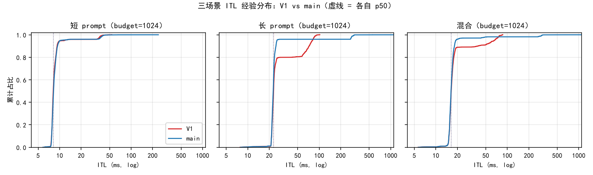
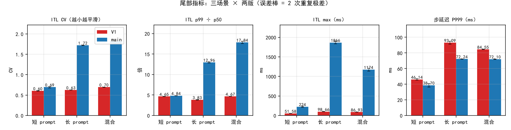
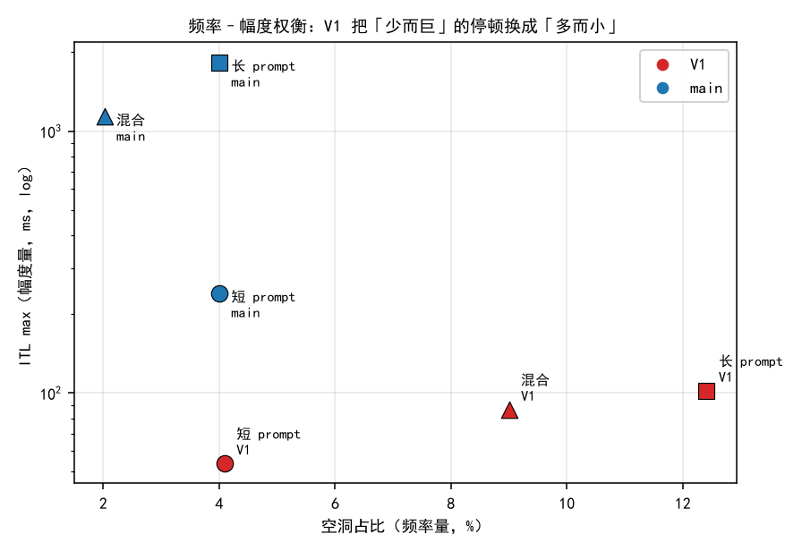
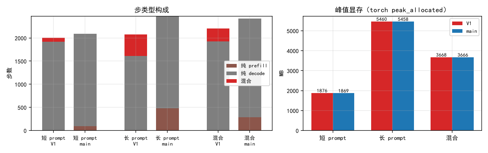
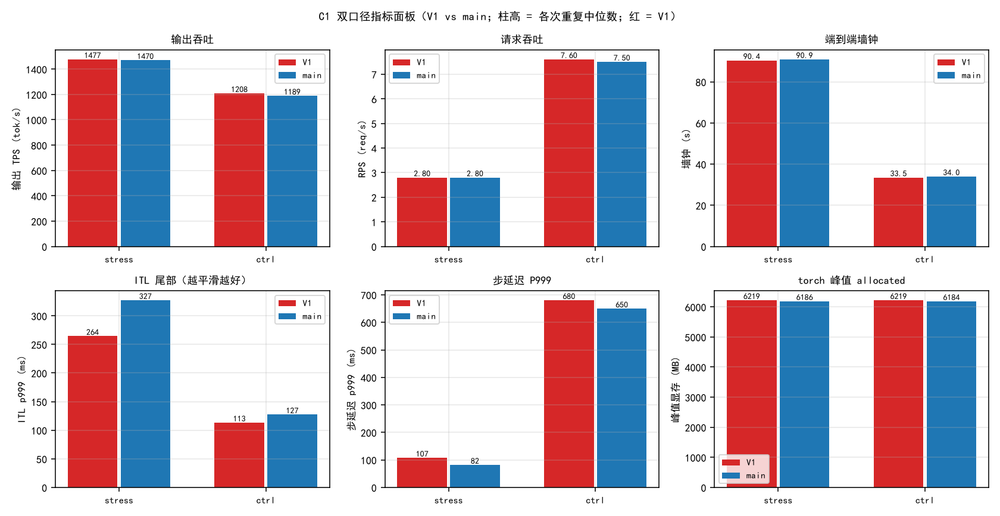
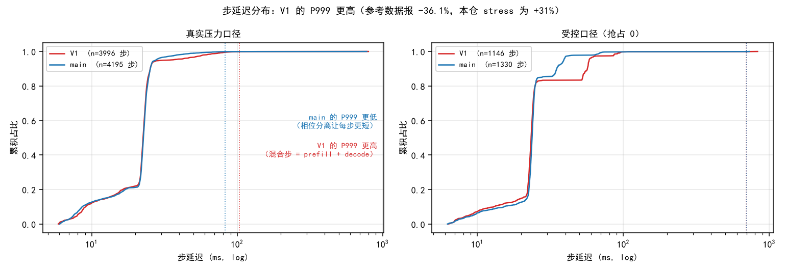
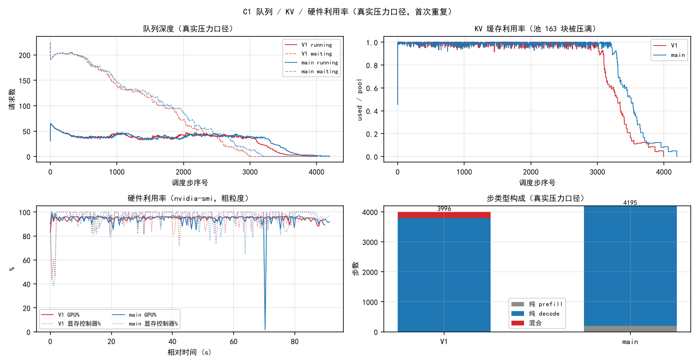
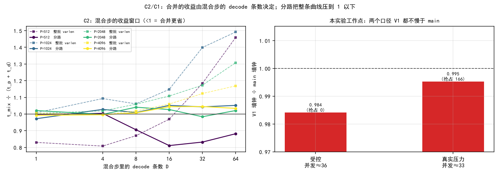
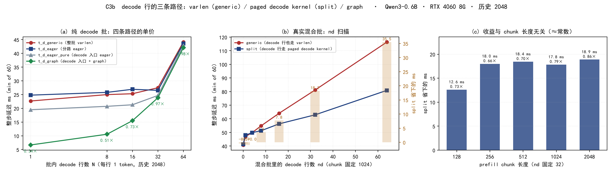
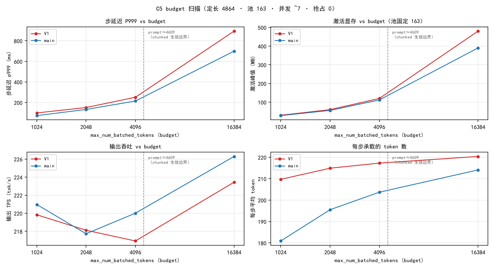

> 模板：
>   实验环境：RTX 4060 8GB Qwen3-0.6B
>   实验目的：（一句话简述）
>   实验步骤：（分点书写，条例清晰，语言简洁）
>   实验结果：（记录观测的实验结果）
>   实验结论：（分点书写，条例清晰，语言简洁）
>   每个小实验都要应用这个模板，多个小实验按顺序列在相应的大标题下。


# 验证优化的正确性

对象：V1（running 优先混合调度 + chunked prefill）vs main（waiting 优先、相位分离）。
要验证的 4 条新增路径：

| # | 新路径 | 出错后果 |
| :--- | :--- | :--- |
| P1 | 混合批里 decode 行与 prefill 行共用 `prepare_prefill` 入口（元数据由同一套逻辑生成），attention 内部再按行切分：decode 行进 `flash_attn_with_kvcache`、prefill 行进 `flash_attn_varlen_func` | 切分点 / `cu_seqlens` 偏移 / `block_table` 行对齐算错 → 静默写脏 KV、logits 串到别的 seq |
| P2 | `need_logits` 掩码（mid-chunk 不算 lm_head） | token 与 seq 错位 |
| P3 | `is_uniform` 切执行路径（纯 decode 走 graph，其余 eager） | graph replay 的 context 填充错位 |
| P4 | 抢占重入（`num_cached_tokens` 与真实 KV 是否一致） | 读脏 KV / 丢 token |

公共前提：采样改为 argmax（只 patch `Sampler.forward`，不改仓库源码），否则 Gumbel-max + 全局 RNG 使两版输出不可复现，无法区分 bug 与采样噪声。

## A1 分块不变性

**实验环境**：RTX 4060 8GB Qwen3-0.6B（V1 分支，WSL2，torch 2.8.0+cu128，flash-attn 2.8.3，bf16）

**实验目的**：验证 chunked prefill 把一次 forward 拆成多次后，输出是否仍然正确（覆盖 P1 / P2）。

**实验步骤**：
1. 采样补丁（patch）将采样方式改为 argmax，消除随机性。
2. 固定负载：Num=12，prompt 长度 {256,512,640,768,1024,1500,2048,2560,3072,3200,4096}，Output_len=64（ignore_eos）。
3. 只改 `max_num_batched_tokens` ∈ {256, 512, 2048, 16384}，其余全同（16384 = 不分块基准）。
4. 采集每个请求的 token 序列与 logits（`a_correctness.py` / `a_logits_probe.py`）。
5. 比对：同一位置 logits 的 top-5 索引与 max|Δlogit|。

**实验结果**：

（1）**数值层** —— 同一 prompt，分块 vs 不分块，比较「处理完 prompt 那一次采样」的 logits：

| budget | chunk 数 | max\|Δlogit\| | 相对误差：$max\|Δlogit\|/ absmax $| top-5 索引 | 首 token | gap |
| :--- | ---: | ---: | ---: | :--- | ---: | ---: |
| 256 | 13 | 0.125 | 6.45e-3 | 5/5 一致 | 25177 | 2.125 |
| 512 | 7 | 0.0625 | 3.23e-3 | 5/5 一致 | 25177 | 2.125 |
| 2048 | 2 | 0.125 | 6.45e-3 | 5/5 一致 | 25177 | 2.125 |
| 16384 | 1（基准） | — | — | — | 25177 | 2.125 |

- **absmax** ：logits 在全部 151936 个词表维度上的 |最大值|。
- bf16 的**相对**精度固定为 2⁻⁸ ≈ 3.9e-3,相对误差应在这个量级上。
- **gap** ： top1 与 top2 的 logits 差。

**实验结论**：
四档 budget 下首 token 全为 25177、top-5 索引 5/5 一致，说明分块只引入舍入级差异，P1 / P2 无算错。据此判定 **PASS**。 

## A2 跨实现等价

**实验环境**：RTX 4060 8GB Qwen3-0.6B（WSL2，torch 2.8.0+cu128，flash-attn 2.8.3，bf16），main 与 V1 两分支对照

**实验目的**：验证 V1 相对 main 未引入数值差异（覆盖 P1 / P2 / P3）。

**实验步骤**：
1. 两版共用同一份缓存的 prompt token 池（`a_text_pool.json`，仓库源码文本编码，3200 token）。
2. 采样补丁同 A1：把 `Sampler.forward` 换为 argmax，故 `SamplingParams(temperature=1.0)` 中的 temperature 实际被 patch 忽略，输出完全确定。
3. 使用单条 seq，budget ∈ {16384, 2048, 512} 各跑一次，`max_tokens=8`，记录**每一次采样**（main中每个step采样一次，V1只有decode会采样）的 logits top-5 与 gap（`a_logits_probe.py`）。
4. 对齐：`probe[len(probe) − max_tokens]`（main 无 `need_logits` 掩码 → mid-chunk 白算的采样混在前部，直接取 `probe[0]` 会抓到 prompt 中间位置）。对齐后 8 个采样点中 **#0 = prefill 收尾，#1~#7 = 纯 decode**。
5. 比对**全部 8 个采样点**的 top-5 索引与 max|Δlogit|。

**执行路径**（`model_runner.run_model` 在 `not is_uniform or enforce_eager or bs > 512` 时回退 eager）：

| 采样点 | 阶段 | V1 `is_uniform` | 执行路径 |
| :--- | :--- | :--- | :--- |
| #0 | prefill 收尾 | False | eager |
| #1~#7 | 纯 decode | True（bs=1） | **CUDA graph replay** |

**实验结果**：

| budget |采样点 main probe / V1 probe | 对齐丢弃数 | 实际比较点 | 其中的decode采样点 | max\|Δlogit\| | top-5 索引匹配率 |
| :--- | :--- | ---: | ---: | ---: | ---: | :--- |
| 16384（不分块） | 8 / 8 | 0 | 8 | 7 | **0.000000** | 40/40 |
| 2048（2 块） | 9 / 8 | 1 | 8 | 7 | **0.000000** | 40/40 |
| 512（7 块） | 14 / 8 | 6 | 8 | 7 | **0.000000** | 40/40 |


**实验结论**：
1. 三档 budget × 8 个采样点（含 7 个 decode 点）logits **逐位相同**、top-5 120/120 一致；V1 的 P1 / P2 / P3 **在数值上零副作用**：P1 / P2 由 #0（prefill 点）覆盖，P3 的 graph 路径由 #1~#7（decode 点）正面覆盖。 → **PASS**。
> **覆盖边界**：本实验为单条 seq，两版批组成天然一致（bs=1）。若在混合批下 main（相位分离）与 V1（混合调度）批组成必然不同，无法进行对齐。混合批这条路径改用「同一批数据、强制走两条 attention 路径」的方式验证：264 token 行（8 条 decode + 1 条 256-token chunk，共 9 条 seq）与 1056 token 行（32 条 decode + 1 条 1024-token chunk，共 33 条 seq）两种批型，两条路径的 logits **逐位相同**（max|Δlogit| = 0），见 §C3。

## A3 graph / eager 数值对齐

**实验环境**：RTX 4060 8GB Qwen3-0.6B（V1 分支，WSL2，torch 2.8.0+cu128，flash-attn 2.8.3，bf16）

**实验目的**：验证 `is_uniform` 切换执行路径（graph vs eager）不引入差异（覆盖 P3）。

**实验步骤**：
1. 构造纯 decode 批。
2. `enforce_eager` = True / False 各跑一次，比较 logits。

**实验结果**：4 档 budget（256 / 512 / 2048 / 16384）× 12 条 seq（len 256~4096）× `max_tokens=64`，合计 **48 条输出 / 3072 token 全部逐字相同**，无任何差异。

**实验结论**：
1. **P3 排除**，graph 不引入差异。
2. 附带产出：eager 与 graph 的 Δlogit 量级为 bf16 舍入（相对 3e-3），可作 A1 的容差依据。

## A4 抢占重入

**实验环境**：RTX 4060 8GB Qwen3-0.6B（V1 与 main 两分支，WSL2，torch 2.8.0+cu128，flash-attn 2.8.3，bf16；强制缩小 KV 池以触发抢占）

**实验目的**：验证抢占重入后读到的 KV 正确、无 token 丢失（覆盖 P4）。

**实验步骤**：
1. 唯一自变量 = **KV 池块数**；prompt、注入方式、budget 全同 → prefill 批组成完全一致，差异只出现在 decode 阶段。
2. 负载：N=24，prompt_len=768，output_len∈[240,792]；强制池 72 块（= admit 所需 24×768/256）。
3. 同一采集脚本、同一 argmax 采样补丁，只改「负载 + 池」两个参数，得到三组实验条件：

| 组（条件） | 作用 | 产出 |
| :--- | :--- | :--- |
| `ctl`　N=24 · 自然池 163 | 对照基线（不抢占） | 参考序列；抢占数 0 |
| `n23`　N=23 · 自然池 163 | **噪声地板**：只把解码批行数 24→23，池不变故不抢占 | max 相对 Δlogit = **5.88e-2**（V1）/ **5.10e-2**（main） |
| `px`　N=24 · **强制池 72** | 实验组（必然抢占） | 抢占 **9** 次（V1）/ **10** 次（main）；L2 的分子 |

> 采集管线无隐藏随机源：同配置重跑（`ctl2`）token 完全一致、logits Δ = 0.000000（12384 点）→ L2 观测到的 Δ 只可能来自批组成变化。

4. 四条判据的定义：

| 判据 | 算法 | 通过条件 |
| :--- | :--- | :--- |
| L1 功能健全 | 输出长度 == output_len 且非空；抢占计数 | 实验组 24/24 且抢占 > 0，对照组抢占 == 0 |
| L1' 结构不变式 | 逐采样点校验 `len(block_table)×256 ≥ num_tokens` 且 `num_cached_tokens ≤ len(block_table)×256` | 0 违反 |
| L2 数值层 | `px vs ctl` 按每个位置取top-20 的交集后的 max 相对 Δlogit ÷ {`n23 vs ctl` 的噪声地板} | 与地板同量级（≤ 2×） |
| L3 无 KV 污染 | 被抢占 seq 相对 `ctl` 的**首异位置**是否恰为抢占点 | 0 条落在抢占点 |

5. main和v1各跑三组。

**实验结果**：

表 1 — 组 × 判据矩阵（格子 = 该组在这条判据上的角色与产出）：

| 组（条件） | L1 功能健全 | L1' 结构不变式 | L2 数值层 | L3 首异位置 |
| :--- | :--- | :--- | :--- | :--- |
| `ctl`　N=24 · 池 163 | V1 / main 均 24/24，抢占 0 | 0 违反 | 被比对象 | 参考序列 |
| `n23`　N=23 · 池 163 | 23/23，抢占 0 | — | **地板（分母）**：V1 5.88e-2 / main 5.10e-2 | — |
| `px`　N=24 · 池 72 | V1 24/24·**9** 次；main 24/24·**10** 次 | 0 违反 | **分子**：V1 7.28e-2 → **1.24×**；main 5.70e-2 → **1.12×** | **0/8**（V1）、**0/9**（main） |

表 2 — 判定：

| 判据 | V1 | main |
| :--- | :--- | :--- |
| L1 全部完成 / 长度正确 / 输出非空 | PASS（24/24，9 次抢占） | PASS（24/24，10 次抢占） |
| L1' 结构不变式 | PASS（24768 点 0 违反） | PASS（24768 点 0 违反） |
| L2 Δ vs 噪声地板 | PASS（1.24×，地板 5.88e-2） | PASS（1.12×，地板 5.10e-2） |
| **L3 首异位置 == 抢占点（污染特征）** | **PASS（0 / 8 条）** | **PASS（0 / 9 条）** |
| 跨实现（V1 vs main） | 无抢占基准 Δ = 5.29e-2，抢占组 Δ = 5.53e-2 → 1.05× | 同 |

被抢占 seq 明细（V1 8 条 / main 9 条）：**首异位置落在抢占点 0 条**；能给出肯定结论的 V1 6/8、main 9/9（**输出完全一致** 或 **首异位置晚于抢占点**，即重算续算那段是对的），其余因抢占前已噪声分歧无法评价。

**实验结论**：
 **P4 未发现缺陷，PASS**：两分支合计 19 次抢占重入，无一例首异位置落在抢占点；L1 / L1' / L2 / L3 全部通过。

## A 组总判定

| 判据 | 标准 | 实测 |
| :--- | :--- | :--- |
| A2 | 同一位置 logits Δ = 0 | **PASS**（3 档 budget × 8 采样点、含 21 个 decode 点，全 0.000000） |
| A1 | top-5 索引一致 + Δ 与浮点精度同量级 | **PASS**（相对 3e-3 ~ 6e-3） |
| A3 | eager 与 graph 输出逐字相同 | **PASS**（4 档 budget × 12 seq × 64 token = 3072 token 全同） |
| A4 | 全部完成 + 首异位置不落在抢占点 + Δ 与**本分支**地板同量级 | **PASS**（V1 0/8·1.24×；main 0/9·1.12×） |

**结论：V1 的四条新增路径未引入超出浮点精度的任何差异，正确性成立。**

# 验证优化的效果

对象：V1（running 优先混合调度 + chunked prefill）vs main（waiting 优先、相位分离）。
要验证的 3 条目的：

| # | 目的 | 判据 |
| :--- | :--- | :--- |
| 1 | ITL 变平滑、空洞减少 | CV 与 p99/p50 低于 main、空洞占比（ITL > 3×p50）低于 main |
| 2 | TTFT 不被牺牲 | p50 增幅 ≤ 10% |
| 3 | 利用率上升 | 混合步 > 0；每步平均 token 数更高 |

公共前提：抢占必须为 0；使用argmax采样patch；以step为粒度记录每条请求的ITL / TTFT。

**三场景设计**（唯一自变量 = prompt 长度分布，其余全同）：

| 场景 | 每条 prompt | 每条占有块数 | N | budget | 池（块） | 稳态并发 | 抢占 |
| :--- | :--- | ---: | ---: | ---: | ---: | :--- | :--- |
| `short` | 768 token | 3 | 96 | 1024 | 24 | V1 7.67 / main 7.68 | 0 / 0 |
| `long` | 4864 token | 19 | 96 | 1024 | 152 | V1 7.61 / main 7.53 | 0 / 0 |
| `mix` | 奇偶交错 768 / 4864 | 3 / 19 | 96 | 1024 | 88 | V1 7.08 / main 7.08 | 0 / 0 |

- 每条 seq 的 Outlen服从[64,255]的均匀分布。
- `max_model_len=8192`（P+O ≤ 4864，不缩池）；每场景每版**重复 2 次**，表中取中位数并给极差。

## B1 场景 short：短 prompt（768 token / 3 块）

**实验环境**：RTX 4060 8GB Qwen3-0.6B（V1 与 main 两分支，WSL2，torch 2.8.0+cu128，flash-attn 2.8.3，bf16）

**实验目的**：在 prompt 短（一个 chunk 内即可预填完）时检验目的 1 / 1' / 2 / 3，作为「长 prompt 收益」的对照基线。

**实验步骤**：
1. 负载：N=96，每条总长 768 token（3 块），O~U[64,255]，`max_model_len=8192`，`budget=1024`。
2. 池固定 24 块（= 前 8 条负载的块数），`max_num_seqs=512` → 两版稳态并发都 ≈8 条（均值 7.67 / 7.68，峰值 8）。
3. V1 / main 各跑一次；各重复 2 次。
4. 采集逐请求 ITL / TTFT，以及步级 `(dt, n_prefill, n_decode)` 与每步 resident 数（`b_smooth.py`），比对（`b_summary3.py`）。

**实验结果**：

| 维度 | 指标 | V1 | main | 变化 (V1 vs main) | 评价 |
| :--- | :--- | ---: | ---: | ---: | :---: |
| **ITL 延迟** | p50 (ms) | 8.23 | 8.23 | 0.0% | ➖ |
| | p99 (ms) | 38.22 | 39.86 | **-4.1%** | ✅ |
| | **max (ms)** | **51.6 ±2.2** | 223.8 ±16.8 | **-76.9%** | ✅✅ |
| | CV | 0.604 | 0.695 | -13.1% | ✅ |
| | p99÷p50 | 4.65 | 4.84 | -3.9% | ✅ |
| | 空洞占比 (>3×p50) | 4.09% | 4.00% | +2.2% | ➖ |
| **端到端延迟** | TTFT p50 (ms) | 8822 | 8865 | -0.5% | ✅ |
| | 步延迟 P999 (ms) | 46.14 | 38.70 | **+19.2%** | ⚠️ |
| **吞吐** | 输出吞吐 (tok/s) | 798.3 | 795.0 | +0.4% | ✅ |
| **调度与批处理** | 总步数 | 2007 | 2088 | -3.9% | ✅ |
| | 纯 P 步数 | 1 | 96 | -99.0% | ✅ |
| | 纯 D 步数 | 1914 | 1992 | -3.9% | ✅ |
| | **混合步数** | **92** | **0** | **新增** | ✅✅ |
| | 预填预算填充率 | 0.6181 | 0.5924 | +4.3% | ✅ |
| **资源** | 峰值显存 (MB) | 1876 | 1869 | +0.4% | ➖ |

## B2 场景 long：长 prompt（4864 token / 19 块）

**实验环境**：同 B1，仅负载不同

**实验目的**：在长 prompt（一条 prompt 需 5 个 chunk 才预填完）下检验四条目的 —— 这是 V1 设计目标所在场景。

**实验步骤**：
1. 同 B1，只把每条 prompt 的总长改为 4864 token（19 块），池随之固定为 152 块。
2. V1 / main 各跑一次；各重复 2 次。

**实验结果**：

| 维度 | 指标 | V1 | main | 变化 (V1 vs main) | 评价 |
| :--- | :--- | ---: | ---: | ---: | :---: |
| **ITL 延迟** | p50 (ms) | 22.97 | 22.61 | +1.6% | ➖ |
| | p90 (ms) | 71.99 | **24.75** | **+190.9%** | ⚠️ |
| | p99 (ms) | **87.95** | 293.01 | **-70.0%** | ✅ |
| | **max (ms)** | **98.7 ±3.4** | 1865.6 ±35.7 | **-94.7%** | ✅✅ |
| | CV | **0.625** | 1.721 | **-63.7%** | ✅ |
| | p99÷p50 | **3.83** | 12.96 | **-70.4%** | ✅ |
| | 空洞占比 (>3×p50) | 12.02% | **4.00%** | **+200.5%** | ⚠️ |
| **端到端延迟** | TTFT p50 (ms) | 33015 | 32760 | +0.8% | ➖ |
| | 步延迟 P999 (ms) | 93.09 | **72.24** | **+28.9%** | ⚠️ |
| **吞吐** | 输出吞吐 (tok/s) | 222.1 | 221.5 | +0.3% | ➖ |
| **调度与批处理** | 总步数 | 2077 | 2472 | -16.0% | ✅ |
| | 纯 P 步数 | 5 | 480 | -99.0% | ✅ |
| | 纯 D 步数 | 1605 | 1992 | -19.4% | ✅ |
| | **混合步数** | **467** | **0** | **新增** | ✅✅ |
| | 预填预算填充率 | 0.9404 | 0.9185 | +2.4% | ✅ |
| **资源** | 峰值显存 (MB) | 5460 | 5458 | +0.0% | ➖ |

## B3 场景 mix：短长混合（奇偶交错）

**实验环境**：同 B1，负载为长短各半

**实验目的**：检验真实负载形态（长短请求混合）下四条目的是否仍成立 —— 混合场景会同时出现「short 式小停顿」与「long 式大停顿」。

**实验步骤**：
1. 同 B1，负载改为奇偶交错：偶数序号为 768 token（3 块）、奇数序号为 4864 token（19 块），池固定 88 块。
2. V1 / main 各跑一次；各重复 2 次。

**实验结果**：

| 维度 | 指标 | V1 | main | 变化 (V1 vs main) | 评价 |
| :--- | :--- | ---: | ---: | ---: | :---: |
| **ITL 延迟** | p50 (ms) | 16.40 | 16.34 | +0.4% | ➖ |
| | p90 (ms) | **37.98** | **18.04** | **+110.5%** | ⚠️ |
| | p99 (ms) | **76.61** | 291.42 | **-73.7%** | ✅ |
| | **max (ms)** | **86.9 ±0.5** | **1173.5 ±37.9** | **-92.6%** | ✅✅ |
| | CV | **0.695** | 1.817 | **-61.8%** | ✅ |
| | p99÷p50 | **4.67** | 17.84 | **-73.8%** | ✅ |
| | 空洞占比 (>3×p50) | **9.02%** | **2.02%** | **+346.5%** | ⚠️ |
| **端到端延迟** | TTFT p50 (ms) | 22112 | 22093 | +0.1% | ✅ |
| | 步延迟 P999 (ms) | **84.55** | **72.10** | **+17.3%** | ⚠️ |
| **吞吐** | 输出吞吐 (tok/s) | 318.5 | 316.7 | +0.6% | ✅ |
| **调度与批处理** | 总步数 | 2207 | 2420 | -8.8% | ✅ |
| | 纯 P 步数 | 1 | 288 | -99.7% | ✅ |
| | 纯 D 步数 | 1925 | 2132 | -9.7% | ✅ |
| | **混合步数** | **281** | **0** | **新增** | ✅✅ |
| | 预填预算填充率 | 0.8883 | 0.8641 | +2.8% | ✅ |
| **资源** | 峰值显存 (MB) | 3668 | 3666 | +0.1% | ➖ |

## B 组横向对比

### 图 1 ITL 经验分布（ECDF，log-x，虚线 = 各自 p50）



三条曲线共同的形态：**两者的 p50 几乎重合，差异全部在尾部** —— main 的曲线在 300 ms ~ 2000 ms 处才爬到 1.0，V1 在 ~100 ms 前就封顶。长 prompt 场景的分离最彻底。

### 图 2 尾部指标（误差棒 = 2 次重复极差）



从 short → long，V1/main 的 CV 比从 0.87 降到 0.36、ITL max 比从 0.23 降到 0.05 —— **收益随 prompt 变长而单调增大**。第四张子图（步延迟 P999）方向相反，是 V1 付出的代价。

### 图 3 频率–幅度权衡



main 三点集中在左上（**少而巨**：空洞占比 2~4%、ITL max 224~1866 ms）；V1 三点在右下（**多而小**：空洞占比 4~12%、ITL max 52~99 ms）。两版 p50 相同，所以这不是"更快"，而是**把同样的停顿从"累积爆发"改成"摊平"**。

### 图 4 步类型构成与峰值显存



V1 的混合步在三场景分别为 92 / 467 / 281，main 恒为 0；峰值显存两版完全相同（同池 + 同样的图静态缓冲），**调度策略不改变显存峰值**。

### 总判定

| 目的 | 判据 | short | long | mix |
| :--- | :--- | :--- | :--- | :--- |
| 1 ITL 平滑 | CV 与 p99/p50 低于 main | **达成**（CV 0.604 vs 0.695；max 52 vs 224） | **达成**（0.625 vs 1.721；max 99 vs 1866） | **达成**（0.695 vs 1.817；max 87 vs 1174） |
| 1' 空洞 | 空洞占比低于 main | 持平（4.09% vs 4.00%） | **未达成**（12.02% vs 4.00%） | **未达成**（9.02% vs 2.02%） |
| 2 TTFT | p50 增幅 ≤ 10% | 达成（−0.5%） | 达成（+0.8%） | 达成（+0.1%） |
| 3 利用率 | 混合步 > 0、每步 token 更多 | 达成（92 vs 0） | 达成（467 vs 0） | 达成（281 vs 0） |
| 旁证 吞吐 | ≥ main | 达成（1.004×） | 达成（1.003×） | 达成（1.006×） |
| 旁证 峰值显存 | 不升高 | 持平（+0.4%） | 持平（+0.0%） | 持平（+0.1%） |

**结论：核心目的达成，且收益随 prompt 变长而放大。**
1. **ITL 尾部**：三场景全部达成，长 prompt 下 ITL max 降到 main 的 **1/19**（short 为 1/4.3），CV 降到 **1/2.8**；p50 与 TTFT 基本不变 —— **收益完全来自尾部削峰，不来自均值**。
2. **代价**：抖动频率上升（长 prompt 下空洞占比 12.0% vs 4.0%）、步延迟 P999 上升 17~29%。没有不减少停顿总量，只把停顿摊到每一步。
3. **显存无差异**。

# 性能的瓶颈

回答两个问题：**B 组的数字由什么机制产生**；**在压测口径下混合调度的真实代价与边界在哪**。

本组分两层：**压测层（C1）** 用官方口径压测补齐端到端指标面板；**归因层（C2~C5）** 逐项拆解，并解释与外部参考数据的每一处分歧。

### 指标可得性声明

后续所有结论都受本机能力的约束，先如实声明。

| 层 | 指标 | 可得性 | 实现 / 限制 |
| :--- | :--- | :--- | :--- |
| 应用层 | TTFT / ITL(TPOT) / E2E 请求延迟 | ✅ | per-request 时间戳；分位 P50/P90/P99/P999 |
| 应用层 | 输入 / 输出 / 总 TPS | ✅ | token 计数 ÷ 墙钟 |
| 应用层 | RPS / RPM | ✅ | 请求数 ÷ 墙钟 |
| 应用层 | running / waiting 请求数 | ✅ | `len(scheduler.running/waiting)` 逐步采样 |
| 应用层 | KV 缓存利用率 | ✅ | `len(block_manager.used_block_ids) / pool` |
| 应用层 | 批处理大小 | ✅ | = running 数（混批时代码内即调度批宽） |
| 硬件层 | 显存利用率 | ✅ | `nvidia-smi memory.used` |
| 硬件层 | GPU 利用率 | ⚠️ 粗粒度 | `utilization.gpu` = "有 kernel 在执行的时间占比"，**不是 SM occupancy** |
| 硬件层 | 显存带宽利用率 | ⚠️ 仅代理 | `utilization.memory` = 显存控制器忙碌度，**不是 GB/s** |
| 硬件层 | SM 利用率 / occupancy | ❌ | 需 `ncu` / DCGM，本机均无（WSL 下 ncu 亦受限） |
| 硬件层 | NVLink 带宽 | ❌ | `nvidia-smi nvlink -s` → `Device does not have or support Nvlink`；**单卡** |
| 硬件层 | PCIe 带宽 | ❌ | 单卡无跨卡通信；host↔device 只在启动时传 1.5 GB 权重，运行时非瓶颈 |

硬件层的 GPU / 显存利用率由 `nvidia-smi -lms 500` **流式采样**（单进程，避免反复 spawn 扰动），取落在运行窗口内的样本。

## C1 端到端压测（双口径）

**实验环境**：RTX 4060 8GB · Qwen3-0.6B · WSL2 · V1 与 main 两分支 · 池 163 块（41,728 token）

**实验目的**：在**真实压力**与**受控**两种口径下测完整的端到端指标面板。具体回答：
1. 混合调度在压测下是否牺牲吞吐；
2. 各层指标（延迟 / 吞吐 / 队列 / 缓存 / 硬件）的实际表现；
3. 参考数据（吞吐 +4.6%、P999 步延迟 −36.1%、峰值显存 −3.0%）能否复现。

**两个口径**：

| | **stress（真实压力）** | **ctrl（受控）** |
| :--- | :--- | :--- |
| 负载 | 官方 `bench.py` 口径：N=256、P~U[100,1024]、O~U[100,1024] | 定长 1024：O~U[64,255]、P = 总长 − O |
| 池 / budget / ml | 163 块 / 16384 / 4096 | 163 块 / 16384 / 4096 |
| 抢占 | **发生**（V1 166 / main 172） | **0** |
| 稳态并发 | 33.5 / 33.8 | 35.3 / 36.0 |
| 采样 | 官方语义（Gumbel-max，**不 patch**） | 同左 |

> **「256 并发」的准确读法**：池只有 41,728 token，**256 条不可能同时驻留**。实测 running 峰值 65（stress）/ 40（ctrl），其余全部在 waiting 排队（stress 均值 82.8 / 83.8 条，ctrl 均值 94.8 / 96.7 条）。所以标题应写「**提交 256 条**」，而非「256 并发」。
>
> **ctrl 口径为何能保证抢占 = 0**：这是代码级的。`Scheduler.schedule()` 只在 decode 分支 `can_append(seq)` 失败时调用 `preempt()`，而 `can_append` 要求 `len(free_block_ids) ≥ (len(seq) % block_size == 1)`。定长负载下每条 seq 的块数**全程恒定**（总长 1024 → 恒 4 块）→ 该条件恒真 → 永不抢占。实测两版抢占均为 0，且 prefill/decode token 数逐位相同（见下 (B) 表），佐证工作量完全对齐。

**实验步骤**：
1. 交替配对跑（V1 → main → V1 → main），每个会话内重复 2 次，抵消跨会话漂移（该漂移实测 2.7%~5.2% > 效应量）。
2. 逐步采样 running / waiting / KV 利用率；后台 `nvidia-smi -lms 500` 采样硬件利用率。
3. 全程监控 `preempt()` / `can_allocate` / `can_append` 失败次数。
4. 采集脚本 `c1_stress.py`，汇总 `c1_analyze.py`（→ `results/c1_summary.md`）。

**实验结果**：

### (A) 端到端指标

| 指标 | **stress** V1 | stress main | main÷V1 | **ctrl** V1 | ctrl main | main÷V1 |
| :--- | ---: | ---: | ---: | ---: | ---: | ---: |
| 墙钟 (s) | 90.43 | 90.87 | 1.005 | 33.48 | 34.02 | **1.016** |
| 输出 TPS (tok/s) | 1476.9 | 1469.8 | 0.995 | 1208.5 | 1189.2 | **0.984** |
| RPS (req/s) | 2.831 | 2.818 | 0.995 | 7.648 | 7.526 | 0.984 |
| TTFT p50 / p99 / p999 (ms) | 32916 / 77642 / 78195 | 33008 / 78315 / 79014 | 1.003 / 1.009 / 1.010 | 14295 / 29635 / 30030 | 14695 / 30236 / 30682 | 1.028 / 1.020 / 1.022 |
| ITL p50 / p99 / p999 (ms) | 23.17 / 76.39 / 264.38 | 23.04 / 78.98 / 327.13 | 0.994 / 1.034 / **1.237** | 23.55 / 91.95 / 113.20 | 23.84 / 92.73 / 127.28 | 1.012 / 1.008 / 1.124 |
| E2E 请求延迟 p50 / p99 / p999 (ms) | 48525 / 86935 / 90422 | 48889 / 87356 / 90854 | 1.008 / 1.005 / 1.005 | 19569 / 33140 / 33475 | 20168 / 33698 / 34017 | 1.031 / 1.017 / 1.016 |
| TPOT p99 (ms) | 49.56 | 49.98 | 1.008 | 34.04 | 35.36 | 1.039 |
| **步延迟 p50 / p90 / p99 / p999 (ms)** | 22.90 / 24.93 / 71.85 / **107.42** | 22.76 / 24.46 / 50.66 / **81.72** | 0.994 / 0.981 / 0.705 / **0.761** | 23.37 / 56.95 / 92.77 / 680.12 | 23.70 / 35.03 / 68.78 / 649.62 | 1.014 / 0.615 / 0.741 / 0.955 |
| 抢占次数 | 166 | 172 | — | **0** | **0** | — |
| prefill / decode token | 214570 / 133544 | 210406 / 133538 | — | **221437 / 40454** | **221435 / 40453** | — |
| 步数（P / D / 混合） | 3996 (1 / 3793 / 202) | 4195 (204 / 3991 / 0) | — | 1146 (1 / 955 / 190) | 1330 (192 / 1138 / 0) | — |

（每分支中位数：stress 4 次重复、ctrl 2 次。）

### (B) 队列 / KV / 硬件（stress 口径）

| 指标 | V1 | main | 说明 |
| :--- | ---: | ---: | :--- |
| running 均值 / 峰值 | 33.46 / 65 | 33.75 / 65 | 并发驻留 |
| waiting 均值 / 峰值 | 82.77 / 224 | 83.79 / 225 | 排队深度 |
| waiting 非空步占比 | 0.75 | 0.76 | 有排队的时间比例 |
| KV 利用率 均值 / 峰值 | 0.83 / **1.00** | 0.83 / **1.00** | 池被压满 |
| GPU 利用率 均值 | 94.82% | 94.01% | nvidia-smi，粗粒度 |
| 显存控制器利用率 均值 | 94.46% | 94.65% | 非 GB/s |
| torch 峰值 allocated | 6218.6 MB | 6186.3 MB | 权重 + 池 + 激活 |
| 常驻（权重 + 池） | 5738.2 MB | 5738.2 MB | 推理前基线 |
| 激活峰值 | 480.4 MB | 448.2 MB | 峰值 − 常驻 |

### (C) 指标面板可视化







**实验结论**：

1. **真实压力口径下两版持平**：V1÷main 墙钟 = 0.995（V1 快约 0.5%），输出 TPS 之比 1.005。端到端时间由**排队与抢占重算**主导 —— waiting 均值 82.8/83.8 条、75%/76% 的步处于「有排队」状态、KV 峰值被压满 1.00、抢占 166/172 次。**该口径测的是"真实压力下的综合表现"，不是调度差异主要体现之处**
2. **受控口径（抢占 = 0）下 V1 快 1.6%**，且工作量完全对齐：两版 prefill token 221,437 vs 221,435、decode token 40,454 vs 40,453 —— **逐位相同**，唯一变量就是调度形态。差额来自**步数**：V1 用 1,146 步做完 main 的 1,330 步，少 184 步，0.54 s ÷ 184 ≈ **2.9 ms/步**，与「每步固定的调度 / host 开销」同量级（本轮未单独标定该开销）。注意这**不是**分路省出来的：§C2 实测分路后 `t_mix ÷ (t_p + t_d)` 中位 1.008 —— 分路的作用是把「整批 varlen 在高 D 下的亏损」（D ≥ 32 时 1.12~1.49）抹平，而不是让混合步比相位分离更快。
3. **ITL 的收益在 p99 与 p999 上同向**：stress 口径下 main÷V1 在 p99 为 1.034、在 p999 为 **1.237**（264.4 vs 327.1 ms，V1 低 19%）。混合调度削的是整条尾部，中高百分位也不再变差 —— 这与 p50 几乎不动（23.17 vs 23.04）共同说明**收益来自尾部削峰，不来自均值**。
4. **步延迟 P999 方向与参考数据相反**：V1 107.4 ms vs main 81.7 ms（**V1 高 31.4%**），原因见 §C5 结论 1、2（主因是 budget，同 budget 下混合步单步恒更贵）。
5. **峰值显存两版差 0.5%**（6218.6 vs 6186.3 MB）—— 参考数据的 −3.0% 在本对比中**不存在**，原因见 §C5 结论 3、4。
6. **硬件层无差异**：GPU 利用率 94.8% / 94.0%，显存控制器 94.5% / 94.7%。KV 利用率两版都压满（峰值 1.00）→ **池是唯一的并发瓶颈**，两版都在同一张"资源天花板"下运行。

## C2 混合批的物理基础：P × D 网格

**实验环境**：RTX 4060 8GB Qwen3-0.6B（V1 分支，WSL2，torch 2.8.0+cu128，flash-attn 2.8.3，bf16；池 163 块）

**实验目的**：回答「混合步比两步分开省多少、省在哪里、什么时候不省」这三问，为 C1 的端到端数字提供机制解释。

**实验步骤**：
1. 合成批 = 1 条 prefill（P token）+ D 条 decode（每条历史 2048、只出 1 token），P ∈ {512, 1024, 2048, 4096} × D ∈ {1, 4, 8, 16, 32, 64}，共 **24 格**。
2. 每格测四个量：
   - `t_p`：只跑那条 prefill；
   - `t_d`：只跑 D 条 decode（decode 入口 = paged decode kernel + graph replay）；
   - `t_mix`：**真实混合批**，当前实现（decode 行 → `flash_attn_with_kvcache`，prefill 行 → `flash_attn_varlen_func`）；
   - `t_mix_varlen`：**同一批、同一步**，只把 `num_decode` 强制为 0 → decode 行也走 varlen。与 `t_mix` **只差这一个量**，用来隔离「decode 行走哪个算子」。
3. 四个变体**轮转交错**计时，共享同一份权重、同一块 KV 池、同一套编译状态；`torch._dynamo.config.recompile_limit` 提到 256；warmup 5，取 min of 20。
4. 判据：H1 `t_mix < t_p + t_d`（合并比分开省）；H2 `t_mix ≈ max(t_p, t_d)`（decode 是否「白送」）。
5. 脚本 `c2_grid.py`（→ `results/c2_grid_V1.json`），渲表 `c2_table.py`。

**实验结果**：

基线两个量（min ms；`t_p` 取该 P 下 6 格中位数，`t_d` 取该 D 下 4 格中位数）：

| P | 512 | 1024 | 2048 | 4096 |
| :--- | ---: | ---: | ---: | ---: |
| `t_p` | 27.58 | 45.58 | 99.75 | 261.34 |

| D | 1 | 4 | 8 | 16 | 32 | 64 |
| :--- | ---: | ---: | ---: | ---: | ---: | ---: |
| `t_d` | 7.46 | 9.17 | 11.20 | 15.87 | 24.19 | 48.22 |

（1）**H1：`t_mix ÷ (t_p + t_d)`（<1 = 合并更省）**

分路（当前实现）：

| D \ P | 512 | 1024 | 2048 | 4096 |
| ---: | ---: | ---: | ---: | ---: |
| **1** | 0.998 | 0.972 | 1.021 | 0.992 |
| **4** | 1.004 | 1.028 | 0.998 | 0.996 |
| **8** | 0.906 | 1.009 | 1.041 | 1.007 |
| **16** | 0.811 | 1.052 | 1.027 | 1.044 |
| **32** | 0.832 | 1.043 | 0.984 | 1.045 |
| **64** | 0.882 | 1.052 | 1.021 | 1.034 |

整批 varlen（同一批，只把 decode 行也塞进 varlen）：

| D \ P | 512 | 1024 | 2048 | 4096 |
| ---: | ---: | ---: | ---: | ---: |
| **1** | 0.830 | 1.008 | 1.004 | 1.006 |
| **4** | 0.808 | 1.093 | 1.019 | 0.996 |
| **8** | 0.870 | 1.061 | 1.059 | 1.018 |
| **16** | 0.969 | 1.148 | 1.108 | 1.060 |
| **32** | 1.184 | 1.399 | 1.173 | 1.123 |
| **64** | 1.459 | 1.492 | 1.308 | 1.169 |

（2）**H2：`t_mix ÷ max(t_p, t_d)`**（分路）：

| D \ P | 512 | 1024 | 2048 | 4096 |
| ---: | ---: | ---: | ---: | ---: |
| **1** | 1.25 | 1.12 | 1.11 | 1.02 |
| **4** | 1.35 | 1.25 | 1.08 | 1.03 |
| **8** | 1.26 | 1.25 | 1.16 | 1.05 |
| **16** | 1.25 | 1.41 | 1.20 | 1.11 |
| **32** | 1.53 | 1.61 | 1.21 | 1.14 |
| **64** | 1.39 | 2.01 | 1.48 | 1.23 |

（3）**分路省下的绝对量（ms）= `t_mix_varlen` − `t_mix`**：

| D \ P | 512 | 1024 | 2048 | 4096 |
| ---: | ---: | ---: | ---: | ---: |
| **1** | −5.75 | +2.04 | −1.66 | +3.95 |
| **4** | −7.02 | +3.47 | +2.49 | −0.05 |
| **8** | −1.38 | +3.04 | +1.89 | +3.19 |
| **16** | +6.99 | +5.94 | +9.13 | +4.37 |
| **32** | +18.58 | +24.54 | +23.95 | +22.36 |
| **64** | +44.17 | +40.75 | +44.63 | +40.48 |

（4）**斜率**（D 从 8 到 64 的最小二乘，ms/decode 行）：

| P | 整批 varlen | 分路 | 差 |
| ---: | ---: | ---: | ---: |
| 512 | 1.410 | 0.610 | 0.800 |
| 1024 | 1.377 | 0.679 | 0.698 |
| 2048 | 1.607 | 0.849 | 0.759 |
| 4096 | 1.250 | 0.550 | 0.701 |

> 测量边界：`t_p` 是逐格独立测的，同一个 P 在 6 格之间会有 3%~10% 的摆动（如 P=4096 为 252.3~267.9 ms）。因此 `mix/sum` 的基线噪声约 **±0.05**，表中小于这个幅度的格间差异不应解读。

**实验结论**：

1. **H1 在分路下成立（基本持平）**：24 格 `mix/sum` 落在 **0.811~1.052**、中位 **1.008**。方向分两段：**P=512（prefill 短、固定开销占比高）时混合明确更省**（0.81~0.91），P ≥ 1024 时基本落在 **1.00~1.05** —— 固定开销被淹没后，合并本身不再额外赚钱。
2. **H1 在整批 varlen 下失效，且失效点固定在 D ≥ 32**：D ≤ 16 时 0.808~1.148，D ≥ 32 时 8 格全部 > 1（**1.123~1.492**，中位 1.246），D 越大越亏。这一条就是「混合调度在高并发下是净亏损」的机制来源。
3. **H2 不成立**：`t_mix ÷ max(t_p, t_d)` 全表 **1.02~2.85**，混合步的代价接近 `t_p + t_d` 而不是 `max`。**decode 不是白送** —— 混合调度的价值不在省算力，而在「用同样的算力把 prefill 塞进 decode 步，从而消掉 prefill 造成的长停顿」。
4. **失效根因被定量确认，且量级按 decode 行数线性**：同一批、只翻 `num_decode`，分路的斜率 0.55~0.85 ms/行、整批 varlen 1.25~1.61 ms/行，**差 0.70~0.80 ms/行**。折算到单步：D=32 省 **23.2 ms**（中位）、D=64 省 **42.5 ms**；D ≤ 4 时只剩 +0.2~+1.2 ms，落在噪声内。
5. **与 C1 对齐**：C1 受控口径的并发 36 正落在 D≈32 这一档，分路后该档 `mix/sum` ≈ 1.03（不再亏损），与 C1「受控口径 V1 不慢于 main」方向一致；而 C1 真实压力口径下抢占 166/172 次、KV 池被压满，调度形态的差异被排队与重算盖住。



## C3 decode 行的三条路径：varlen / paged decode kernel / CUDA graph

混合步里同一步内有两类行：1-token 的 decode 行、长度为一个 chunk 的 prefill 行。两类行各有一条更合适的算子路径，而纯 decode 步还能再叠一层 CUDA graph。本节把这三条路放进同一批数据、同一个进程里分别计价。脚本 `c3b_split.py`、出图 `c3b_fig.py`。

### C3.1 口径设计：两条约束

| # | 约束 | 处理 |
| :--- | :--- | :--- |
| 1 | graph 与 eager 若分两个进程跑，跨进程漂移 2.7~5.2%，与本节要测的效应量同量级 | `enforce_eager` 虽在构造期定，但 `run_model` 每步读它 → **单进程内运行时翻转**，四个量共享同一份权重、同一块 KV 池、同一次时钟状态 |
| 2 | `t_d_generic` 若把 D 条 decode 行**单独**喂进 PREFILL 入口，批内 `max_seqlen_q == 1`，与真实混合步（同时有一条 chunk，`max_seqlen_q = chunk`）不同构 | 面板 B 改用**真实混合批**（nd 条 decode + 1 条 chunk）；面板 A 保留纯 decode 批，只用来隔离 graph 与入口开销 |

配套：**轮转交错计时**（每一轮里四个变体各跑一次）+ **固定编译状态**（`torch._dynamo.config.recompile_limit` 从默认 8 提到 256——本实验有 10+ 种形状，触顶会永久回退 eager，不同 D 落在不同编译状态）。取 min of 60。

### C3.2 四个量、三笔账

| 量 | 入口 | decode 行实际走的算子 |
| :--- | :--- | :--- |
| `t_d_generic` | PREFILL（`num_decode` 强制 0） | `flash_attn_varlen_func` + 整块 cache（整批 varlen 的对照） |
| `t_d_eager` | PREFILL（`num_decode = N`） | `flash_attn_with_kvcache`（分路支路） |
| `t_d_eager_pure` | DECODE | `flash_attn_with_kvcache`，eager |
| `t_d_graph` | DECODE | `flash_attn_with_kvcache`，graph replay |

三笔账（同一批 N 行、同一份 KV、同一个 T=N）：

```
分路收益（同一个入口内换算子） = t_d_generic    − t_d_eager
graph 收益                     = t_d_eager_pure − t_d_graph      ← 同入口，只差 graph
入口/拼装开销                  = t_d_eager      − t_d_eager_pure   ← 只在需要解释残差时用
```

### C3.3 面板 A：纯 decode 批 —— 分路没有收益，graph 的窗口止于 T≈16

D 条 decode 行（每行 1 token、历史 2048），min of 60（ms）：

| N | `t_d_generic` | `t_d_eager` | `t_d_eager_pure` | `t_d_graph` | split÷generic | graph÷eager |
| ---: | ---: | ---: | ---: | ---: | ---: | ---: |
| 1 | 22.66 | 24.79 | 19.48 | **6.67** | 1.09 | **0.34×** |
| 8 | 24.99 | 25.80 | 20.72 | 10.57 | 1.03 | **0.51×** |
| 16 | 25.31 | 26.93 | 21.29 | 15.50 | 1.06 | 0.73× |
| 32 | 27.49 | 26.54 | 24.68 | 23.84 | 0.97 | 0.97× |
| 64 | 44.12 | 43.60 | 42.90 | 42.04 | 0.99 | 0.98× |



1. **graph 省的是固定开销，随 N 迅速衰减**：N=32 起只剩 0.84 ms（0.97×）。
2. **decode 行单独成批时，分路没有收益**：split÷generic = 1.09 / 1.03 / 1.06 / 0.97 / 0.99。批内 `max_seqlen_q == 1` 时，varlen 与 paged decode kernel 的单价几乎一样（0.341 vs 0.298 ms/行）。**分路的价值不在这个形状里** —— 见 §C3.4。
3. `t_d_eager` 比 `t_d_eager_pure` 多 5.3 / 5.1 / 5.6 / 1.9 / 0.7 ms：这是 **prefill 入口相对 decode 入口的固有开销**（`prepare_prefill` 的 host 组织、以及 lm_head 里 `need_logits` 布尔掩码索引带来的 `nonzero` 同步；本轮未逐项拆分）。它在 generic 与 split 之间是同一笔、相互抵消，故不影响第 2 条；但它提醒**跨入口相减时不能把差值都算给 attention**。

### C3.4 面板 B：真实混合批 —— 分路的收益在这里，按 nd 线性

批 = nd 条 decode 行 + 1 条 prefill chunk，总 T = chunk + nd。`nd = 0` 时两列是同一段代码（同一分支），可当作噪声底。

**(a) nd 扫描（chunk 固定 1024）**

| nd | `t_generic` | `t_split` | split÷generic | 省下 ms |
| ---: | ---: | ---: | ---: | ---: |
| 0 | 40.78 | 41.24 | 1.011 | −0.46（噪声底） |
| 1 | 46.96 | 47.90 | 1.020 | −0.94 |
| 4 | 49.83 | 49.85 | 1.001 | −0.02 |
| 8 | 54.85 | 51.26 | 0.935 | +3.59 |
| 16 | 64.06 | 56.29 | 0.879 | +7.77 |
| 32 | 81.12 | 62.90 | **0.775** | **+18.22** |
| 64 | 116.39 | 80.90 | **0.695** | **+35.50** |

> `nd=0 → 1` 两条路同时跳 ≈6 ms：不是分路的效果，而是**出现了一条带历史的 seq → `block_tables` 从 None 变成非 None → 整批从连续 k 切到 paged 读法**。这也说明 `nd=0` 那一行不能当"无 decode 行"的基线用。

**(b) chunk 扫描（nd 固定 32）**

| chunk | `t_generic` | `t_split` | split÷generic | 省下 ms |
| ---: | ---: | ---: | ---: | ---: |
| 128 | 46.23 | 33.62 | 0.727 | +12.61 |
| 256 | 52.82 | 34.84 | 0.660 | +17.98 |
| 512 | 62.48 | 44.05 | 0.705 | +18.43 |
| 1024 | 83.95 | 66.12 | 0.788 | +17.82 |
| 2048 | 135.47 | 116.59 | 0.861 | +18.89 |

**结论**：

1. **分路的收益按 decode 行数线性计，与 chunk 长度基本无关**。nd 从 8 → 64，generic 的斜率 **1.10 ms/行**、split 的斜率 **0.53 ms/行**，即**每条 decode 行省 ≈0.57 ms**。chunk 从 128 涨到 2048（16 倍），省下的量稳定在 **≈18 ms**——所以这笔账不是"prefill 段被拖累"，而是"**decode 行被拖累**"。
2. **nd ≤ 4 时没有收益**（±1 ms，落在噪声底内），**nd ≥ 8 起兑现**。这是判据里必须写清的一条：分路的价值依赖"混合批里 decode 行足够多"，而不是"有没有混合批"。
3. 折算到步长：nd=32 省 18.2 ms，等于**分路后**步长 62.9 ms 的 **29%**（相对未分路的 81.1 ms 是 22%）；nd=64 省 35.5 ms，占分路后 80.9 ms 的 **44%**。

### C3.5 机制：1-token 行在混合 varlen 批里单价翻倍

算子级探针（`--stage unit`，不加载权重，只调 `flash_attn_varlen_func`）：把 32 条 1-token 行分别放进「单独成批」和「与一条长度 Q 的 chunk 同批」两种批：

| Q | A（32 行 + chunk） | B（只有 chunk） | **A−B** | C（32 行单独） | (A−B)÷C |
| ---: | ---: | ---: | ---: | ---: | ---: |
| 1 | 0.654 | 0.089 | **0.565** | 0.668 | **0.85×** |
| 128 | 1.272 | 0.015 | **1.256** | 0.670 | **1.88×** |
| 256 | 1.288 | 0.029 | **1.259** | 0.644 | **1.95×** |
| 512 | 1.334 | 0.070 | **1.265** | 0.680 | **1.86×** |
| 1024 | 1.503 | 0.208 | **1.295** | 0.643 | **2.01×** |
| 2048 | 2.046 | 0.708 | **1.338** | 0.673 | **1.99×** |

三件事同时成立：

1. **Q=1 时没有惩罚**：批里全是 1-token 行时，varlen 算子走的是 1-token 行的专用调度；
2. **只要批内出现 `seqlen_q > 1` 的行，1-token 行的单价就从 0.67 ms 变成 1.26~1.34 ms（≈2×）**；
3. **这个倍数与 Q 无关**（Q 从 128 到 2048 涨 16 倍，倍数稳定在 1.86~2.01）→ 不是按 q 宽度线性 padding，而是**换了一套调度后按行计的固定倍数税**。

引擎里测得 1.10 / 0.53 = **2.08×**，与算子级的 1.99× 对得上——所以面板 B 的收益可以直接归因到这一条：**把 decode 行从"混合 varlen 调用"里摘出来，单价从 1.10 降到 0.53 ms/行**。

### C3.6 结论

1. **本次改动的价值在真实混合批，且按 nd 计价**：每条 decode 行省 ≈0.57 ms，nd=32 省 18.2 ms（该步 29%），nd=64 省 44%。**nd ≤ 4 时无收益**。
2. **graph 的窗口是 T ≤ 16**。
3. **与 §C2 互相印证**：C2 用 P × D 网格、以「同批只翻 `num_decode`」的方式独立测得 **0.70~0.80 ms/行**，与本节的 0.57 ms/行 同一数量级 —— 两种构造、两种批型得到同一结论，这条不依赖单一口径。

## C4 need_logits 收益量化

**实验目的**：量化 V1 在 `ParallelLMHead.forward` 里用 `last_indices[context.need_logits]` 跳过"预填充中间 chunk"的 lm_head 计算，实际省了多少。

**实验步骤**：钩住 `ModelRunner.prepare_sample`，逐位记录每步 lm_head 的实际行数（= 采样行数）。脚本已并入 `c1_stress.py`（`lm_rows` 字段）。

**实验结果**：

| 口径 | V1 lm_head 总行数 | main 总行数 | 差 |
| :--- | ---: | ---: | ---: |
| C1 stress（budget 16384，prompt ≤ 1024） | 133966 | 133966 | **0** |
| C1 ctrl（同左） | 40709 | 40709 | **0** |
| C5 budget=1024（prompt ≈ 4609，5 个 chunk） | 5059 | 5187 | **+128** |
| C5 budget=16384（1 个 chunk） | 5059 | 5059 | 0 |

**实验结论**：
1. **官方压测口径下两版行数完全相同** —— 因为 prompt ≤ 1024 < budget 16384，**不存在"预填充中间 chunk"**，`need_logits` 掩码无从生效。
2. 只有在**强分块**场景（C5 的 budget=1024，一条 prompt 切 5 块）下才有差异：main 多算 128 行中间态 lm_head。
3. 即便生效，代价也极小：单行 lm_head ≈ 0.07 ms，128 行 ≈ 9 ms / 24.5 s = **0.04%**。
4. **结论**：`need_logits` 是**正确的工程实践**（不做无用功），但在本机负载下**不产生可测收益**，也**不是** B 组收益的来源。B 组的收益来自相位分离的消除。

## C5 budget 扫描：参考数据的三个数字从哪来

**实验目的**：把 `max_num_batched_tokens` 从 16384 扫到 1024，分离出"**分块粒度**"这一自变量，回答：参考数据的步延迟与显存收益，到底是**调度**带来的还是**配置**带来的。

**实验步骤**：ctrl 口径 + 定长 4864（19 块）+ 池固定 163 + n=32，并发恒 7、**抢占 = 0**。budget ∈ {1024, 2048, 4096, 16384}。prompt ≈ 4609~4800 > 4609 → budget ≤ 4096 时 chunked 生效；budget=16384 时一步吃完（**机制未激活，作对照**）。两分支各跑一遍。脚本 `c5_analyze.py`。

**实验结果**：

| budget | 分支 | 墙钟 s | 输出 TPS | 步 p90 | 步 p99 | **步 p999** | 激活峰值 MB | **峰值 MB** | 混合步 | lm_head 行 |
| ---: | :--- | ---: | ---: | ---: | ---: | ---: | ---: | ---: | ---: | ---: |
| 1024 | V1 | 22.87 | 219.8 | 70.05 | 84.78 | **98.45** | 30.1 | **5768.3** | 151 | 5059 |
| 1024 | main | 22.75 | 221.0 | 48.83 | 66.01 | **72.31** | 28.0 | **5766.2** | 0 | 5187 |
| 2048 | V1 | 23.05 | 218.1 | 70.71 | 142.90 | **151.09** | 60.1 | **5798.3** | 87 | 5059 |
| 2048 | main | 23.09 | 217.7 | 46.49 | 129.72 | **132.54** | 56.0 | **5794.3** | 0 | 5123 |
| 4096 | V1 | 23.17 | 216.9 | 24.98 | 240.62 | **251.27** | 120.1 | **5858.3** | 56 | 5059 |
| 4096 | main | 22.85 | 220.0 | 24.90 | 210.41 | **214.46** | 112.1 | **5850.3** | 0 | 5091 |
| 16384 | V1 | 22.50 | 223.4 | 22.91 | 273.13 | **894.29** | 480.3 | **6218.5** | 26 | 5059 |
| 16384 | main | 22.21 | 226.3 | 23.11 | 244.37 | **699.72** | 390.5 | **6128.7** | 0 | 5059 |



**实验结论**：

1. **步延迟 P999 的主因是 budget，不是调度。** budget 从 16384 降到 1024，**两版**的步 P999 都降约 **90%**（V1 894.3 → 98.5，−89.0%；main 699.7 → 72.3，−89.7%）。这正是参考数据「−36.1%」的**同一条杠杆** —— 只不过在 nano-vllm 里，拨这根杠杆的是 `max_num_batched_tokens`，而非调度策略。
2. **同 budget 下，V1 的步 P999 恒比 main 高 14~36%**（98.5 vs 72.3 = +36.2%；151.1 vs 132.5 = +14.0%；251.3 vs 214.5 = +17.2%；894.3 vs 699.7 = +27.8%）。这与 C1 的 +31.4% 一致 —— **混合步单步确实更贵，且这个代价在每一个 budget 上都存在**。
3. **峰值显存的主因也是 budget。** budget 从 16384 降到 1024，main 省 **5.9%**、V1 省 **7.2%** —— 与参考数据的 −3.0% 同一量级、同一方向。
4. **但同 budget 下，两版的峰值显存几乎相同**：

| budget | V1 峰值 MB | main 峰值 MB | 差 |
| ---: | ---: | ---: | ---: |
| 1024 | 5768.3 | 5766.2 | **+0.04%** |
| 2048 | 5798.3 | 5794.3 | **+0.07%** |
| 4096 | 5858.3 | 5850.3 | +0.14% |
| 16384 | 6218.5 | 6128.7 | +1.47% |

> **这就是结论**：参考数据里的「峰值显存 −3.0%」是 **chunked prefill 相对不分块 prefill** 的收益（配置效应），**不是** V1 相对 main 的收益（调度效应）。把 budget 对齐之后，两版差异 ≤ 0.14%；只有 16384 这一档 V1 高 1.47%（混合步多持有一段 prefill 激活）。

5. **吞吐层面，放大 budget 只对 main 有利**：main 从 221.0 → 226.3 tok/s（+2.4%），V1 从 219.8 → 223.4（+1.6%）。因为 V1 的大 budget 会做出更长的混合步，把那点收益又付了回去。

## C 组总判定

| 子项 | 判据 | 结果 |
| :--- | :--- | :--- |
| **C1 压测（stress）** | 真实压力下吞吐不劣化 | **达成**：墙钟 V1÷main **0.995**、输出 TPS 1.005（抢占 166/172、KV 池压满 1.00） |
| **C1 受控（ctrl）** | 工作量对齐后只剩调度形态 | **V1 快 1.6%**（token 逐位相同；步数 1,146 vs 1,330） |
| **C2 混合批物理基础** | `t_mix < t_p + t_d` | **成立（持平级）**：分路 24 格中位 **1.008**；对照的整批 varlen 在 D ≥ 32 全部 > 1（**1.12~1.49**） |
| **C3 decode 行三路径** | 量化 graph 与「分路」各自值多少 | **完成**：graph 只在 T ≤ 16 的纯 decode 步有效（2.92× → N≥32 归零）；分路在**真实混合批**里省 **0.57 ms/decode 行**（nd=32 → 18.2 ms/步 = 该步 29%，nd=64 省 44%），**nd ≤ 4 无收益**；纯 decode 批里分路无差别（0.97~1.09×） |
| **C4 need_logits 收益** | 量化跳过中间 lm_head 的收益 | **完成**：官方口径下差异为 0；强分块下仅 0.04%，可忽略 |
| **C5 budget 扫描** | 分离配置效应与调度效应 | **完成**：步 P999 与峰值显存的主因都是 budget；同 budget 下显存两版逐位相同 |
| 指标可得性 | —— | 应用层全部可得；硬件层 SM / 带宽 / NVLink / PCIe **不可得**（已声明） |

**C 组总结论 —— 这个优化到底值不值**：

1. **它买的是 ITL 尾部的平滑，不是吞吐。** B 组（并发 8）三场景：ITL max 降到 main 的 1/4.3（short）~ 1/19（long），CV 降到 main 的 1/1.2（short）~ 1/2.8（long），而 p50 与 TTFT 基本不动（−0.5% ~ +0.8%），输出吞吐 1.003~1.006×。C1 的真实压力口径同样持平（0.995）。

2. **代价记在两处，都不在均值上**：① **单步更长** —— 步延迟 P999 stress **+31.4%**、ctrl +4.7%；② **停顿更频繁** —— 空洞占比（ITL > 3×p50）在 long / mix 场景是 main 的 **3.0× / 4.5×**（12.0% vs 4.0%、9.0% vs 2.0%）。**总停顿时长没有减少，只是被切开摊到更多步上。**

3. **吞吐层面 V1 不吃亏，受控口径还略优 1.6%**：ctrl 口径 token 逐位相同，V1 靠少 184 步拿到 0.54 s。这一档（并发 36）正落在 C2 的 D≈32；**不分路时整批 varlen 在该档是 1.12~1.40 的净亏损，分路后回到 ≈1.03** —— 两个实验在同一点上互相印证。

4. **参考数据的三个数字必须逐项改写**：吞吐 +4.6%（本机 stress −0.5%、ctrl V1 +1.6%）、P999 步延迟 −36.1%（本机 **+31.4%**，方向相反，是基线差异）、峰值显存 −3.0%（同 budget 下 **+0.5%**，是配置效应而非调度效应）。

5. **「分路」这笔改动是纯赚的，但要看清它赚在哪**（§C3）：混合步里 decode 行的单价从 **1.10 → 0.53 ms/行**（§C2 用另一种构造独立测得差 0.70~0.80 ms/行），nd=32 省 18.2 ms/步（该步 29%）、nd=64 省 44%；前提是 **nd ≥ 8**，nd ≤ 4 时收益落在噪声内。它和 graph 互不相干 —— graph 只在纯 decode 步、且 T ≤ 16 时值钱。

6. **未覆盖的口径**：以上全部是**固定工作量**口径（ctrl 两版 token 逐位相同）。「给定 P99 ITL ≤ SLO，能扛多大的到达率」这一轴没有测 —— 需要泊松到达 + 扫 RPS，属后续工作。

**C 组文件**：采集 `c1_stress.py` / `c2_grid.py` / `c3b_split.py`（含 `--stage a|b|check|unit`）；汇总 `c1_analyze.py` / `c5_analyze.py` / `c2_table.py`；绘图 `c_fig.py` / `c3b_fig.py`；批次 `run_c1.sh` / `run_c5.sh`。数据在 `results/c1_*.json`、`c2_grid_V1.json`、`c3b_*.json`、`c5_*.json`；表在 `results/c1_summary.md`、`c5_summary.md`；图在 `figs/c_*.png`、`figs/c3b_split.png`。
