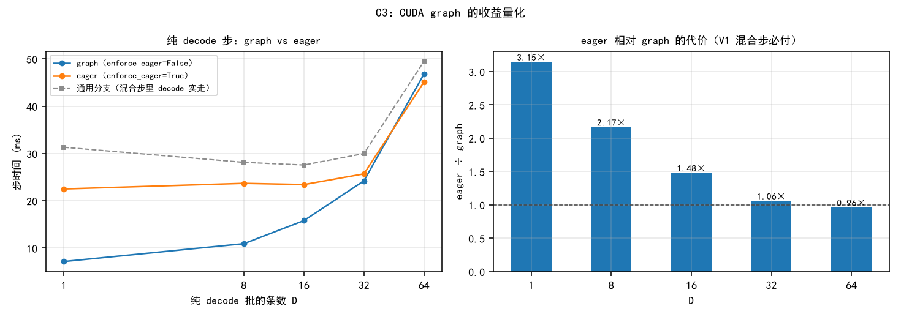

> 模板：
>   实验环境：RTX 4060 8GB Qwen3-0.6B
>   实验目的：（一句话简述）
>   实验步骤：（分点书写，条例清晰，语言简洁）
>   实验结果：（记录观测的实验结果）
>   实验结论：（分点书写，条例清晰，语言简洁）
>   每个小实验都要应用这个模板，多个小实验按顺序列在相应的大标题下。

# 验证优化的正确性

对象：V1（running 优先混合调度 + chunked prefill）vs main（waiting 优先、相位分离）。
要验证的 4 条新增路径：

| # | 新路径 | 出错后果 |
| :--- | :--- | :--- |
| P1 | 混合批里的 decode seq 走 `prepare_prefill` 通用分支 | slot_mapping / positions / cu_seqlens 算错 → 静默写脏 KV |
| P2 | `need_logits` 掩码（mid-chunk 不算 lm_head） | token 与 seq 错位 |
| P3 | `is_uniform` 切执行路径（纯 decode 走 graph，其余 eager） | graph replay 的 context 填充错位 |
| P4 | 抢占重入（`num_cached_tokens` 与真实 KV 是否一致） | 读脏 KV / 丢 token |

公共前提：采样改为 argmax（只 patch `Sampler.forward`，不改仓库源码），否则 Gumbel-max + 全局 RNG 使两版输出不可复现，无法区分 bug 与采样噪声。

## A1 分块不变性

**实验环境**：RTX 4060 8GB Qwen3-0.6B（V1 分支，WSL2，torch 2.8.0+cu128，flash-attn 2.8.3，bf16）

**实验目的**：验证 chunked prefill 把一次 forward 拆成多次后，输出是否仍然正确（覆盖 P1 / P2）。

**实验步骤**：
1. 采样补丁（patch）将采样方式改为 argmax，消除随机性。
2. 固定负载：Num=12，prompt 长度 {256,512,640,768,1024,1500,2048,2560,3072,3200,4096}，Output_len=64（ignore_eos）。
3. 只改 `max_num_batched_tokens` ∈ {256, 512, 2048, 16384}，其余全同（16384 = 不分块基准）。
4. 采集每个请求的 token 序列与 logits（`a_correctness.py` / `a_logits_probe.py`）。
5. 比对：同一位置 logits 的 top-5 索引与 max|Δlogit|。

**实验结果**：

（1）**数值层** —— 同一 prompt，分块 vs 不分块，比较「处理完 prompt 那一次采样」的 logits：

| budget | chunk 数 | max\|Δlogit\| | 相对误差：$max\|Δlogit\|/ absmax $| top-5 索引 | 首 token | gap |
| :--- | ---: | ---: | ---: | :--- | ---: | ---: |
| 256 | 13 | 0.125 | 6.45e-3 | 5/5 一致 | 25177 | 2.125 |
| 512 | 7 | 0.0625 | 3.23e-3 | 5/5 一致 | 25177 | 2.125 |
| 2048 | 2 | 0.125 | 6.45e-3 | 5/5 一致 | 25177 | 2.125 |
| 16384 | 1（基准） | — | — | — | 25177 | 2.125 |

- **absmax** ：logits 在全部 151936 个词表维度上的 |最大值|。
- bf16 的**相对**精度固定为 2⁻⁸ ≈ 3.9e-3,相对误差应在这个量级上。
- **gap** ： top1 与 top2 的 logits 差。

**实验结论**：
四档 budget 下首 token 全为 25177、top-5 索引 5/5 一致，说明分块只引入舍入级差异，P1 / P2 无算错。据此判定 **PASS**。 

## A2 跨实现等价

**实验环境**：RTX 4060 8GB Qwen3-0.6B（WSL2，torch 2.8.0+cu128，flash-attn 2.8.3，bf16），main 与 V1 两分支对照

**实验目的**：验证 V1 相对 main 未引入数值差异（覆盖 P1 / P2 / P3）。

**实验步骤**：
1. 两版共用同一份缓存的 prompt token 池（`a_text_pool.json`，仓库源码文本编码，3200 token）。
2. 采样补丁同 A1：把 `Sampler.forward` 换为 argmax，故 `SamplingParams(temperature=1.0)` 中的 temperature 实际被 patch 忽略，输出完全确定。
3. 使用单条 seq，budget ∈ {16384, 2048, 512} 各跑一次，`max_tokens=8`，记录**每一次采样**（main中每个step采样一次，V1只有decode会采样）的 logits top-5 与 gap（`a_logits_probe.py`）。
4. 对齐：`probe[len(probe) − max_tokens]`（main 无 `need_logits` 掩码 → mid-chunk 白算的采样混在前部，直接取 `probe[0]` 会抓到 prompt 中间位置）。对齐后 8 个采样点中 **#0 = prefill 收尾，#1~#7 = 纯 decode**。
5. 比对**全部 8 个采样点**的 top-5 索引与 max|Δlogit|。

**执行路径**（`model_runner.run_model` 在 `not is_uniform or enforce_eager or bs > 512` 时回退 eager）：

| 采样点 | 阶段 | V1 `is_uniform` | 执行路径 |
| :--- | :--- | :--- | :--- |
| #0 | prefill 收尾 | False | eager |
| #1~#7 | 纯 decode | True（bs=1） | **CUDA graph replay** |

**实验结果**：

| budget |采样点 main probe / V1 probe | 对齐丢弃数 | 实际比较点 | 其中的decode采样点 | max\|Δlogit\| | top-5 索引匹配率 |
| :--- | :--- | ---: | ---: | ---: | ---: | :--- |
| 16384（不分块） | 8 / 8 | 0 | 8 | 7 | **0.000000** | 40/40 |
| 2048（2 块） | 9 / 8 | 1 | 8 | 7 | **0.000000** | 40/40 |
| 512（7 块） | 14 / 8 | 6 | 8 | 7 | **0.000000** | 40/40 |

**实验结论**：
1. 三档 budget × 8 个采样点（含 7 个 decode 点）logits **逐位相同**、top-5 120/120 一致；V1 的 P1 / P2 / P3 **在数值上零副作用**：P1 / P2 由 #0（prefill 点）覆盖，P3 的 graph 路径由 #1~#7（decode 点）正面覆盖。 → **PASS**。
> **覆盖边界**：本实验为单条 seq，两版批组成天然一致（bs=1）。若在混合批下 main（相位分离）与 V1（混合调度）批组成必然不同，无法进行对齐。

## A3 graph / eager 数值对齐

**实验环境**：RTX 4060 8GB Qwen3-0.6B（V1 分支，WSL2，torch 2.8.0+cu128，flash-attn 2.8.3，bf16）

**实验目的**：验证 `is_uniform` 切换执行路径（graph vs eager）不引入差异（覆盖 P3）。

**实验步骤**：
1. 构造纯 decode 批。
2. `enforce_eager` = True / False 各跑一次，比较 logits。

**实验结果**：4 档 budget（256 / 512 / 2048 / 16384）× 12 条 seq（len 256~4096）× `max_tokens=64`，合计 **48 条输出 / 3072 token 全部逐字相同**，无任何差异。

**实验结论**：
1. **P3 排除**，graph 不引入差异。
2. 附带产出：eager 与 graph 的 Δlogit 量级为 bf16 舍入（相对 3e-3），可作 A1 的容差依据。

## A4 抢占重入

**实验环境**：RTX 4060 8GB Qwen3-0.6B（V1 与 main 两分支，WSL2，torch 2.8.0+cu128，flash-attn 2.8.3，bf16；强制缩小 KV 池以触发抢占）

**实验目的**：验证抢占重入后读到的 KV 正确、无 token 丢失（覆盖 P4）。

**实验步骤**：
1. 唯一自变量 = **KV 池块数**；prompt、注入方式、budget 全同 → prefill 批组成完全一致，差异只出现在 decode 阶段。
2. 负载：N=24，prompt_len=768，output_len∈[240,792]；强制池 72 块（= admit 所需 24×768/256）。
3. 同一采集脚本、同一 argmax 采样补丁，只改「负载 + 池」两个参数，得到三组实验条件：

| 组（条件） | 作用 | 产出 |
| :--- | :--- | :--- |
| `ctl`　N=24 · 自然池 163 | 对照基线（不抢占） | 参考序列；抢占数 0 |
| `n23`　N=23 · 自然池 163 | **噪声地板**：只把解码批行数 24→23，池不变故不抢占 | max 相对 Δlogit = **5.88e-2**（V1）/ **5.10e-2**（main） |
| `px`　N=24 · **强制池 72** | 实验组（必然抢占） | 抢占 **9** 次（V1）/ **10** 次（main）；L2 的分子 |

> 采集管线无隐藏随机源：同配置重跑（`ctl2`）token 完全一致、logits Δ = 0.000000（12384 点）→ L2 观测到的 Δ 只可能来自批组成变化。

4. 四条判据的定义：

| 判据 | 算法 | 通过条件 |
| :--- | :--- | :--- |
| L1 功能健全 | 输出长度 == output_len 且非空；抢占计数 | 实验组 24/24 且抢占 > 0，对照组抢占 == 0 |
| L1' 结构不变式 | 逐采样点校验 `len(block_table)×256 ≥ num_tokens` 且 `num_cached_tokens ≤ len(block_table)×256` | 0 违反 |
| L2 数值层 | `px vs ctl` 按每个位置取top-20 的交集后的 max 相对 Δlogit ÷ {`n23 vs ctl` 的噪声地板} | 与地板同量级（≤ 2×） |
| L3 无 KV 污染 | 被抢占 seq 相对 `ctl` 的**首异位置**是否恰为抢占点 | 0 条落在抢占点 |

5. main和v1各跑三组。

**实验结果**：

表 1 — 组 × 判据矩阵（格子 = 该组在这条判据上的角色与产出）：

| 组（条件） | L1 功能健全 | L1' 结构不变式 | L2 数值层 | L3 首异位置 |
| :--- | :--- | :--- | :--- | :--- |
| `ctl`　N=24 · 池 163 | V1 / main 均 24/24，抢占 0 | 0 违反 | 被比对象 | 参考序列 |
| `n23`　N=23 · 池 163 | 23/23，抢占 0 | — | **地板（分母）**：V1 5.88e-2 / main 5.10e-2 | — |
| `px`　N=24 · 池 72 | V1 24/24·**9** 次；main 24/24·**10** 次 | 0 违反 | **分子**：V1 7.28e-2 → **1.24×**；main 5.70e-2 → **1.12×** | **0/8**（V1）、**0/9**（main） |

表 2 — 判定：

| 判据 | V1 | main |
| :--- | :--- | :--- |
| L1 全部完成 / 长度正确 / 输出非空 | PASS（24/24，9 次抢占） | PASS（24/24，10 次抢占） |
| L1' 结构不变式 | PASS（24768 点 0 违反） | PASS（24768 点 0 违反） |
| L2 Δ vs 噪声地板 | PASS（1.24×，地板 5.88e-2） | PASS（1.12×，地板 5.10e-2） |
| **L3 首异位置 == 抢占点（污染特征）** | **PASS（0 / 8 条）** | **PASS（0 / 9 条）** |
| 跨实现（V1 vs main） | 无抢占基准 Δ = 5.29e-2，抢占组 Δ = 5.53e-2 → 1.05× | 同 |

被抢占 seq 明细（V1 8 条 / main 9 条）：**首异位置落在抢占点 0 条**；能给出肯定结论的 V1 6/8、main 9/9（**输出完全一致** 或 **首异位置晚于抢占点**，即重算续算那段是对的），其余因抢占前已噪声分歧无法评价。

**实验结论**：
 **P4 未发现缺陷，PASS**：两分支合计 19 次抢占重入，无一例首异位置落在抢占点；L1 / L1' / L2 / L3 全部通过。

## A 组总判定

| 判据 | 标准 | 实测 |
| :--- | :--- | :--- |
| A2 | 同一位置 logits Δ = 0 | **PASS**（3 档 budget × 8 采样点、含 21 个 decode 点，全 0.000000） |
| A1 | top-5 索引一致 + Δ 与浮点精度同量级 | **PASS**（相对 3e-3 ~ 6e-3） |
| A3 | eager 与 graph 输出逐字相同 | **PASS**（4 档 budget × 12 seq × 64 token = 3072 token 全同） |
| A4 | 全部完成 + 首异位置不落在抢占点 + Δ 与**本分支**地板同量级 | **PASS**（V1 0/8·1.24×；main 0/9·1.12×） |

**结论：V1 的四条新增路径未引入超出浮点精度的任何差异，正确性成立。**

# 验证优化的效果

对象：V1（running 优先混合调度 + chunked prefill）vs main（waiting 优先、相位分离）。
要验证的 3 条目的：

| # | 目的 | 判据 |
| :--- | :--- | :--- |
| 1 | ITL 变平滑、空洞减少 | CV 与 p99/p50 低于 main、空洞占比（ITL > 3×p50）低于 main |
| 2 | TTFT 不被牺牲 | p50 增幅 ≤ 10% |
| 3 | 利用率上升 | 混合步 > 0；每步平均 token 数更高 |

公共前提：抢占必须为 0；使用argmax采样patch；以step为粒度记录每条请求的ITL / TTFT。

**三场景设计**（唯一自变量 = prompt 长度分布，其余全同）：

| 场景 | 每条 prompt | 每条占有块数 | N | budget | 池（块） | 稳态并发 | 抢占 |
| :--- | :--- | ---: | ---: | ---: | ---: | :--- | :--- |
| `short` | 768 token | 3 | 96 | 1024 | 24 | V1 7.67 / main 7.68 | 0 / 0 |
| `long` | 4864 token | 19 | 96 | 1024 | 152 | V1 7.61 / main 7.53 | 0 / 0 |
| `mix` | 奇偶交错 768 / 4864 | 3 / 19 | 96 | 1024 | 88 | V1 7.08 / main 7.08 | 0 / 0 |

- 每条 seq 的 Outlen服从[64,255]的均匀分布。
- `max_model_len=8192`（P+O ≤ 4864，不缩池）；每场景每版**重复 2 次**，表中取中位数并给极差。

## B1 场景 short：短 prompt（768 token / 3 块）

**实验环境**：RTX 4060 8GB Qwen3-0.6B（V1 与 main 两分支，WSL2，torch 2.8.0+cu128，flash-attn 2.8.3，bf16）

**实验目的**：在 prompt 短（一个 chunk 内即可预填完）时检验目的 1 / 1' / 2 / 3，作为「长 prompt 收益」的对照基线。

**实验步骤**：
1. 负载：N=96，每条总长 768 token（3 块），O~U[64,255]，`max_model_len=8192`，`budget=1024`。
2. 池固定 24 块（= 前 8 条负载的块数），`max_num_seqs=512` → 两版稳态并发都恰好 8 条（见注释）。
3. V1 / main 各跑一次；各重复 2 次。
4. 采集逐请求 ITL / TTFT，以及步级 `(dt, n_prefill, n_decode)` 与每步 resident 数（`b_smooth.py`），比对（`b_summary3.py`）。

**实验结果**：

| 维度 | 指标 | V1 | main | 变化 (V1 vs main) | 评价 |
| :--- | :--- | ---: | ---: | ---: | :---: |
| **ITL 延迟** | p50 (ms) | 9.01 | 8.96 | +0.6% | ➖ |
| | p99 (ms) | 35.59 | 42.35 | **-16.0%** | ✅ |
| | **max (ms)** | **45.3 ±0.6** | 233.6 ±2.2 | **-80.6%** | ✅✅ |
| | CV | 0.490 | 0.674 | -27.3% | ✅ |
| | p99÷p50 | 3.96 | 4.72 | -16.1% | ✅ |
| | 空洞占比 (>3×p50) | 4.09% | 4.00% | +2.2% | ➖ |
| **端到端延迟** | TTFT p50 (ms) | 9124 | 9507 | -4.0% | ✅ |
| | 步延迟 P999 (ms) | 43.07 | 40.52 | **+6.3%** | ⚠️ |
| **吞吐** | 输出吞吐 (tok/s) | 756.5 | 734.3 | +3.0% | ✅ |
| **调度与批处理** | 总步数 | 2007 | 2088 | -3.9% | ✅ |
| | 纯 P 步数 | 1 | 96 | -99.0% | ✅ |
| | 纯 D 步数 | 1914 | 1992 | -3.9% | ✅ |
| | **混合步数** | **92** | **0** | **新增** | ✅✅ |
| | 预填预算填充率 | 0.6181 | 0.5924 | +4.3% | ✅ |
| **资源** | 峰值显存 (MB) | 1874 | 1869 | +0.3% | ➖ |

## B2 场景 long：长 prompt（4864 token / 19 块）

**实验环境**：同 B1，仅负载不同

**实验目的**：在长 prompt（一条 prompt 需 5 个 chunk 才预填完）下检验四条目的 —— 这是 V1 设计目标所在场景。

**实验步骤**：
1. 同 B1，只把每条 prompt 的总长改为 4864 token（19 块），池随之固定为 152 块。
2. V1 / main 各跑一次；各重复 2 次。

**实验结果**：

| 维度 | 指标 | V1 | main | 变化 (V1 vs main) | 评价 |
| :--- | :--- | ---: | ---: | ---: | :---: |
| **ITL 延迟** | p50 (ms) | 25.11 | 24.85 | +1.0% | ➖ |
| | p90 (ms) | 76.32 | **26.18** | **+191.5%** | ⚠️ |
| | p99 (ms) | **92.54** | 309.24 | **-70.1%** | ✅ |
| | **max (ms)** | **98.7 ±1.2** | 1985.3 ±1.3 | **-95.0%** | ✅✅ |
| | CV | **0.612** | 1.686 | **-63.7%** | ✅ |
| | p99÷p50 | **3.68** | 12.45 | **-70.4%** | ✅ |
| | 空洞占比 (>3×p50) | 10.54% | **4.00%** | **+163.5%** | ⚠️ |
| **端到端延迟** | TTFT p50 (ms) | 35477 | 35614 | -0.4% | ➖ |
| | 步延迟 P999 (ms) | 95.82 | **74.29** | **+29.0%** | ⚠️ |
| **吞吐** | 输出吞吐 (tok/s) | 205.6 | 204.5 | +0.5% | ➖ |
| **调度与批处理** | 总步数 | 2077 | 2472 | -16.0% | ✅ |
| | 纯 P 步数 | 5 | 480 | -99.0% | ✅ |
| | 纯 D 步数 | 1605 | 1992 | -19.4% | ✅ |
| | **混合步数** | **467** | **0** | **新增** | ✅✅ |
| | 预填预算填充率 | 0.9404 | 0.9185 | +2.4% | ✅ |
| **资源** | 峰值显存 (MB) | 5458 | 5458 | 0.0% | ➖ |

## B3 场景 mix：短长混合（奇偶交错）

**实验环境**：同 B1，负载为长短各半

**实验目的**：检验真实负载形态（长短请求混合）下四条目的是否仍成立 —— 混合场景会同时出现「short 式小停顿」与「long 式大停顿」。

**实验步骤**：
1. 同 B1，负载改为奇偶交错：偶数序号为 768 token（3 块）、奇数序号为 4864 token（19 块），池固定 88 块。
2. V1 / main 各跑一次；各重复 2 次。

**实验结果**：

| 维度 | 指标 | V1 | main | 变化 (V1 vs main) | 评价 |
| :--- | :--- | ---: | ---: | ---: | :---: |
| **ITL 延迟** | p50 (ms) | 17.93 | 17.89 | +0.2% | ➖ |
| | p90 (ms) | **38.44** | **19.18** | **+100.4%** | ⚠️ |
| | p99 (ms) | **80.37** | 303.06 | **-73.5%** | ✅ |
| | **max (ms)** | **84.5 ±0.6** | **1221.7 ±3.0** | **-93.1%** | ✅✅ |
| | CV | **0.657** | 1.777 | **-63.0%** | ✅ |
| | p99÷p50 | **4.48** | 16.94 | **-73.6%** | ✅ |
| | 空洞占比 (>3×p50) | **8.44%** | **2.07%** | **+307.7%** | ⚠️ |
| **端到端延迟** | TTFT p50 (ms) | 23392 | 23998 | -2.5% | ✅ |
| | 步延迟 P999 (ms) | **83.79** | **73.57** | **+13.9%** | ⚠️ |
| **吞吐** | 输出吞吐 (tok/s) | 299.2 | 293.3 | +2.0% | ✅ |
| **调度与批处理** | 总步数 | 2207 | 2420 | -8.8% | ✅ |
| | 纯 P 步数 | 1 | 288 | -99.7% | ✅ |
| | 纯 D 步数 | 1925 | 2132 | -9.7% | ✅ |
| | **混合步数** | **281** | **0** | **新增** | ✅✅ |
| | 预填预算填充率 | 0.8883 | 0.8641 | +2.8% | ✅ |
| **资源** | 峰值显存 (MB) | 3666 | 3666 | 0.0% | ➖ |

## B 组横向对比

### 图 1 ITL 经验分布（ECDF，log-x，虚线 = 各自 p50）

三条曲线共同的形态：**两者的 p50 几乎重合，差异全部在尾部** —— main 的曲线在 300 ms ~ 2000 ms 处才爬到 1.0，V1 在 ~100 ms 前就封顶。长 prompt 场景的分离最彻底。

### 图 2 尾部指标（误差棒 = 2 次重复极差）

从 short → long，V1/main 的 CV 比从 0.73 降到 0.36、ITL max 比从 0.19 降到 0.05 —— **收益随 prompt 变长而单调增大**。第四张子图（步延迟 P999）方向相反，是 V1 付出的代价。

### 图 3 频率–幅度权衡

main 三点集中在左上（**少而巨**：空洞占比 2~4%、ITL max 234~1985 ms）；V1 三点在右下（**多而小**：空洞占比 4~10.5%、ITL max 45~99 ms）。两版 p50 相同，所以这不是"更快"，而是**把同样的停顿从"累积爆发"改成"摊平"**。

### 图 4 步类型构成与峰值显存

V1 的混合步在三场景分别为 92 / 467 / 281，main 恒为 0；峰值显存两版完全相同（同池 + 同样的图静态缓冲），**调度策略不改变显存峰值**。

### 总判定

| 目的 | 判据 | short | long | mix |
| :--- | :--- | :--- | :--- | :--- |
| 1 ITL 平滑 | CV 与 p99/p50 低于 main | **达成**（CV 0.490 vs 0.674；max 45 vs 234） | **达成**（0.612 vs 1.686；max 99 vs 1985） | **达成**（0.657 vs 1.777；max 85 vs 1222） |
| 1' 空洞 | 空洞占比低于 main | 持平（4.09% vs 4.00%） | **未达成**（10.54% vs 4.00%） | **未达成**（8.44% vs 2.07%） |
| 2 TTFT | p50 增幅 ≤ 10% | 达成（−4.0%） | 达成（−0.4%） | 达成（−2.5%） |
| 3 利用率 | 混合步 > 0、每步 token 更多 | 达成（92 vs 0） | 达成（467 vs 0） | 达成（281 vs 0） |
| 旁证 吞吐 | ≥ main | 达成（1.030×） | 持平（1.005×） | 达成（1.020×） |
| 旁证 峰值显存 | 不升高 | 持平（+0.3%） | 持平（0%） | 持平（0%） |

**结论：核心目的达成，且收益随 prompt 变长而放大。**
1. **ITL 尾部**：三场景全部达成，长 prompt 下 ITL max 降到 main 的 **1/20**，CV 降到 **1/2.8**；p50 与 TTFT 基本不变 —— **收益完全来自尾部削峰，不来自均值**。
2. **代价**：抖动频率上升（长 prompt 下空洞占比 10.5% vs 4.0%）、步延迟 P999 上升 6~29%。没有不减少停顿总量，只把停顿摊到每一步。
3. **显存无差异**。

# 性能的瓶颈

回答两个问题：**B 组的数字由什么机制产生**；**在压测口径下混合调度的真实代价与边界在哪**。

本组分两层：**压测层（C1）** 用官方口径压测补齐端到端指标面板；**归因层（C2~C5）** 逐项拆解，并解释与外部参考数据的每一处分歧。

### 指标可得性声明

后续所有结论都受本机能力的约束，先如实声明。

| 层 | 指标 | 可得性 | 实现 / 限制 |
| :--- | :--- | :--- | :--- |
| 应用层 | TTFT / ITL(TPOT) / E2E 请求延迟 | ✅ | per-request 时间戳；分位 P50/P90/P99/P999 |
| 应用层 | 输入 / 输出 / 总 TPS | ✅ | token 计数 ÷ 墙钟 |
| 应用层 | RPS / RPM | ✅ | 请求数 ÷ 墙钟 |
| 应用层 | running / waiting 请求数 | ✅ | `len(scheduler.running/waiting)` 逐步采样 |
| 应用层 | KV 缓存利用率 | ✅ | `len(block_manager.used_block_ids) / pool` |
| 应用层 | 批处理大小 | ✅ | = running 数（混批时代码内即调度批宽） |
| 硬件层 | 显存利用率 | ✅ | `nvidia-smi memory.used` |
| 硬件层 | GPU 利用率 | ⚠️ 粗粒度 | `utilization.gpu` = "有 kernel 在执行的时间占比"，**不是 SM occupancy** |
| 硬件层 | 显存带宽利用率 | ⚠️ 仅代理 | `utilization.memory` = 显存控制器忙碌度，**不是 GB/s** |
| 硬件层 | SM 利用率 / occupancy | ❌ | 需 `ncu` / DCGM，本机均无（WSL 下 ncu 亦受限） |
| 硬件层 | NVLink 带宽 | ❌ | `nvidia-smi nvlink -s` → `Device does not have or support Nvlink`；**单卡** |
| 硬件层 | PCIe 带宽 | ❌ | 单卡无跨卡通信；host↔device 只在启动时传 1.5 GB 权重，运行时非瓶颈 |

硬件层的 GPU / 显存利用率由 `nvidia-smi -lms 500` **流式采样**（单进程，避免反复 spawn 扰动），取落在运行窗口内的样本。

## C1 端到端压测（双口径）

> 本实验取代原「C0 标准 benchmark」（同一负载、同一口径，此处补齐指标面板并新增受控对照）。原 C0 的交替配对结论（0.991）在本节 (D) 复现。

**实验环境**：RTX 4060 8GB · Qwen3-0.6B · WSL2 · V1 与 main 两分支 · 池 163 块（41,728 token）

**实验目的**：在**真实压力**与**受控**两种口径下测完整的端到端指标面板。具体回答：
1. 混合调度在压测下是否牺牲吞吐；
2. 各层指标（延迟 / 吞吐 / 队列 / 缓存 / 硬件）的实际表现；
3. 参考数据（吞吐 +4.6%、P999 步延迟 −36.1%、峰值显存 −3.0%）能否复现。

**两个口径**：

| | **stress（真实压力）** | **ctrl（受控）** |
| :--- | :--- | :--- |
| 负载 | 官方 `bench.py` 口径：N=256、P~U[100,1024]、O~U[100,1024] | 定长 1024：O~U[64,255]、P = 总长 − O |
| 池 / budget / ml | 163 块 / 16384 / 4096 | 163 块 / 16384 / 4096 |
| 抢占 | **发生**（V1 166 / main 172） | **0** |
| 稳态并发 | 33.5 / 33.8 | 35.3 / 36.0 |
| 采样 | 官方语义（Gumbel-max，**不 patch**） | 同左 |

> **「256 并发」的准确读法**：池只有 41,728 token，**256 条不可能同时驻留**。实测 running 峰值 65（stress）/ 40（ctrl），其余全部在 waiting 排队（均值 82.8 / 94.8 条）。所以标题应写「**提交 256 条**」，而非「256 并发」。
>
> **ctrl 口径为何能保证抢占 = 0**：这是代码级的。`Scheduler.schedule()` 只在 decode 分支 `can_append(seq)` 失败时调用 `preempt()`，而 `can_append` 要求 `len(free_block_ids) ≥ (len(seq) % block_size == 1)`。定长负载下每条 seq 的块数**全程恒定**（总长 1024 → 恒 4 块）→ 该条件恒真 → 永不抢占。实测两版抢占均为 0，且 prefill/decode token 数逐位相同（见下 (B) 表），佐证工作量完全对齐。

**实验步骤**：
1. 交替配对跑（V1 → main → V1 → main），每个会话内重复 2 次，抵消跨会话漂移（该漂移实测 2.7%~5.2% > 效应量）。
2. 逐步采样 running / waiting / KV 利用率；后台 `nvidia-smi -lms 500` 采样硬件利用率。
3. 全程监控 `preempt()` / `can_allocate` / `can_append` 失败次数。
4. 采集脚本 `c1_stress.py`，汇总 `c1_analyze.py`（→ `results/c1_summary.md`）。

**实验结果**：

### (A) 端到端指标

| 指标 | **stress** V1 | stress main | main÷V1 | **ctrl** V1 | ctrl main | main÷V1 |
| :--- | ---: | ---: | ---: | ---: | ---: | ---: |
| 墙钟 (s) | 95.28 | 94.29 | 0.990 | 36.80 | 35.27 | **0.958** |
| 输出 TPS (tok/s) | 1401.7 | 1416.3 | 1.010 | 1099.2 | 1147.0 | **1.044** |
| RPS (req/s) | 2.687 | 2.715 | 1.010 | 6.956 | 7.258 | 1.044 |
| TTFT p50 / p99 / p999 (ms) | 34868 / 82336 / 82913 | 34408 / 81416 / 82135 | 0.987 / 0.989 / 0.991 | 15829 / 32874 / 33304 | 15016 / 31347 / 31805 | 0.949 / 0.954 / 0.955 |
| ITL p50 / p99 / p999 (ms) | 24.22 / 86.42 / 281.6 | 24.08 / 82.06 / 335.6 | 0.994 / 0.950 / **1.192** | 24.97 / 103.50 / 128.21 | 24.70 / 95.97 / 131.31 | 0.989 / 0.927 / 1.024 |
| E2E 请求延迟 p50 / p99 / p999 (ms) | 51540 / 91748 / 95279 | 50764 / 90709 / 94287 | 0.985 / 0.989 / 0.990 | — / 36467 / — | — / 34941 / — | — / 0.958 / — |
| TPOT p99 (ms) | 52.53 | 52.05 | 0.991 | 38.62 | 36.88 | 0.955 |
| **步延迟 p50 / p90 / p99 / p999 (ms)** | 24.08 / 25.09 / 81.32 / **118.23** | 23.95 / 24.85 / 51.97 / **85.80** | 0.995 / 0.991 / 0.639 / **0.726** | 24.89 / 69.18 / 104.10 / 664.94 | 24.61 / 35.76 / 70.82 / 649.99 | 0.989 / 0.517 / 0.680 / 0.978 |
| 抢占次数 | 166 | 172 | — | **0** | **0** | — |
| prefill / decode token | 214590 / 133556 | 210406 / 133538 | — | **221442 / 40454** | **221437 / 40453** | — |
| 步数（P / D / 混合） | 3996 (1 / 3793 / 202) | 4195 (204 / 3991 / 0) | — | 1146 (1 / 955 / 190) | 1330 (192 / 1138 / 0) | — |

（每分支中位数：stress 4 次重复、ctrl 2 次。）

### (B) 队列 / KV / 硬件（stress 口径）

| 指标 | V1 | main | 说明 |
| :--- | ---: | ---: | :--- |
| running 均值 / 峰值 | 33.46 / 65 | 33.75 / 65 | 并发驻留 |
| waiting 均值 / 峰值 | 82.77 / 224 | 83.79 / 225 | 排队深度 |
| waiting 非空步占比 | 0.75 | 0.76 | 有排队的时间比例 |
| KV 利用率 均值 / 峰值 | 0.83 / **1.00** | 0.83 / **1.00** | 池被压满 |
| GPU 利用率 均值 | 95.94% | 95.24% | nvidia-smi，粗粒度 |
| 显存控制器利用率 均值 | 96.34% | 96.46% | 非 GB/s |
| torch 峰值 allocated | 6186.5 MB | 6186.3 MB | 权重 + 池 + 激活 |
| 常驻（权重 + 池） | 5738.2 MB | 5738.2 MB | 推理前基线 |
| 激活峰值 | 448.3 MB | 448.2 MB | 峰值 − 常驻 |

### (C) 交替配对（stress 口径，抵消跨会话漂移）

| 配对 | V1 墙钟 (s) | main 墙钟 (s) | V1÷main |
| :--- | ---: | ---: | ---: |
| 1 | 96.372 | 95.161 | 1.013 |
| 2 | 96.188 | 94.296 | 1.020 |
| 3 | 94.371 | 94.279 | 1.001 |
| 4 | 94.304 | 93.641 | 1.007 |
| **均值** | 95.309 | 94.344 | **1.010** |

分支内散布：V1 std 1.124 s、main std 0.624 s。方向与旧 C0 完全一致（旧值 0.991）。

### (D) 指标面板可视化

**实验结论**：

1. **真实压力口径下两版持平**：V1÷main 墙钟 = 1.010（V1 慢约 1%），输出 TPS 之比 0.990，与旧 C0 的 0.991 一致。端到端时间由**排队与抢占重算**主导 —— waiting 均值 82.8/83.8 条、75%/76% 的步处于「有排队」状态、KV 峰值被压满 1.00、抢占 166/172 次。**该口径测的是"真实压力下的综合表现"，不是调度差异的显影剂。**
2. **受控口径（抢占 = 0）下 V1 慢 4.4%**，且这条差异是**可干净归因**的：两版 prefill token 221,442 vs 221,437、decode token 40,454 vs 40,453 —— **逐位相同**，不含任何工作量差异。唯一变量就是调度形态。机制见 §C2/C3：并发 36 已越过混合步的收益窗口。
3. **ITL 的收益出现在 p999、代价出现在 p99**：stress 口径下 main÷V1 在 p99 是 0.950（main 好 5%）、在 p999 是 **1.192**（V1 好 19%）。两条曲线的交叉点落在 p99 与 p999 之间 —— 说明混合调度**削的是极端尾部**，而中高百分位（p90~p99）反而因为混合步的存在略差。**只报 p99 会得出"V1 更差"，只报 max 会得出"V1 大胜"。**
4. **步延迟 P999 方向与参考数据相反**：V1 118.2 ms vs main 85.8 ms（**V1 高 37.8%**），见 §C1.3。
5. **峰值显存两版逐位相同**（6186.5 vs 6186.3 MB，差 0.003%）—— 参考数据的 −3.0% 在本对比中**不存在**，原因见 §C1.3 与 §C5。
6. **硬件层无差异**：GPU 利用率 95.9% / 95.2%，显存控制器 96.3% / 96.5%。KV 利用率两版都压满（峰值 1.00）→ **池是唯一的并发瓶颈**，两版都在同一张"资源天花板"下运行。

### C1.3 与参考数据的三项比对

| 参考指标 | 参考值 | 本机实测 | 判定 | 根因 |
| :--- | ---: | ---: | :--- | :--- |
| 端到端吞吐 | +4.6% | **−1.0%**（V1÷main 1.010） | 不可复现 | ① 跨会话漂移 2.7~5.2% > 效应量 4.6%；② **基线不同**：他们的基线不做 chunk 切分，混合调度的收益面更大 |
| P999 步延迟 | −36.1% | **+37.8%**（118.2 vs 85.8 ms） | **方向相反** | **基线差异**：nano-vllm 的 main 同样受 budget 约束、prefill 已按 16384 切块；V1 的混合步是在切块之上**再叠加** decode → 单步更长。§C5 直接验证：把 budget 从 16384 降到 1024，**两版**的步 P999 都降约 90% |
| 峰值显存 | −3.0% | **−0.003%**（6186.5 vs 6186.3 MB） | **结构性为 0** | KV 池在启动时按 `gpu_memory_utilization` 静态分配，**与调度无关**；两版同配置 → 同池 5738.2 MB。§C5 证明该数只随 budget 变化（配置效应），且**同 budget 下两版逐位相同** |

**关于那个「幅值巧合」**：参考数据的 −36.1% 与本机的 +37.8% 几乎是同一个数、方向相反。这不是巧合，而是**同一机制在两种基线上的不同投影** —— chunked prefill 的本质是"把长 prefill 步切短"。当基线**没有**这个切分时，切分让 P999 骤降；当基线**已经有**这个切分时，V1 额外引入的混合步只会在切分之上再加一段 decode → P999 上升。

## C2 混合批的物理基础（已完成，2026-10-12）

详见 `C2_混合批物理基础结论.md`。结论摘要：

| 假设 | 判定 | 实测 |
| :--- | :--- | :--- |
| H1 `t_mix < t_p + t_d` | **成立但窗口窄** | D ≤ 16 成立（`mix/sum` 0.87~0.99），**D ≥ 32 反转**（1.16~1.30） |
| H2 `t_mix ≈ max(t_p, t_d)` | 不成立 | 收益只是固定开销分摊，不是"decode 白送" |
| 收益来源 | 权重读取 / kernel 固定开销的分摊 | — |
| 失效根因 | 混合批里 decode 必须走 `flash_attn_varlen_func` + paged KV；纯 decode 走专用 `flash_attn_with_kvcache` | `c2_shape.py` 用两个旋钮分离 |

**对 C1 的直接解释**：受控口径并发 36 **> 32**，正落在混合步的亏损区 → 解释了 (A) 表中 V1 慢 4.4%。

## C3 CUDA graph 收益量化

**实验目的**：量化 V1 混合步付出的一笔具体代价 —— 混合步（prefill chunk + decode）整步被迫走 **eager**，而 main 的纯 decode 步全程享受 **CUDA graph replay**。

**实验步骤**：绕过调度器，在 ModelRunner 层构造纯 decode 批（D 条、历史长 2048），用 CUDA event 计时 `run()`。分别以 `enforce_eager=False`（graph）与 `True`（eager）跑两次独立进程。脚本 `c3_graph.py`。

**实验结果**（ms，取最小 GPU 时间）：

| D | graph | eager | eager÷graph | 通用分支 † | 通用÷graph |
| ---: | ---: | ---: | ---: | ---: | ---: |
| 1 | 7.15 | 22.49 | **3.15×** | 31.32 | 4.38× |
| 8 | 10.93 | 23.69 | **2.17×** | 28.12 | 2.57× |
| 16 | 15.81 | 23.43 | **1.48×** | 27.56 | 1.74× |
| 32 | 24.21 | 25.69 | 1.06× | 29.97 | 1.24× |
| 64 | 46.78 | 45.11 | **0.96×** | 49.48 | 1.06× |

† 通用分支 = `run(seqs, PREFILL)`，即混合步里 decode seq 实际走的路径（A 组 P1 路径）。

**实验结论**：
1. **graph 的收益是"固定开销摊销"，随 D 增大迅速衰减**：D=1 时 3.15×，D=16 时 1.48×，**D ≥ 32 后基本消失**（D=64 时 eager 反而略快）。
2. **混合步里 decode 走的是通用分支**，它比 graph 慢：D=32 时 29.97 vs 24.21 = **+5.8 ms/步**。
3. 这解释了 V1 的代价为何在**高并发**下才显现：受控口径 190 个混合步 × ~6 ms ≈ 1.1 s ≈ 35.3 s 的 3.2%（实测 4.4%，余量来自步数与尾部差异）。**低并发时这笔税相对收益很小，高并发时收益消失、税还在。**

> ⚠ **C6 修正（后补）**：上面第 2、3 条的「+5.8 ms/步」是**把 D 条 decode 单独喂进通用分支**测出来的，那批的 **T 只有 32**，正落在"固定 launch 开销主导"的区间；把它外推到 T≈1050 的真实混合步不成立。
>
> C6（`c6_prefill_graph.py`，真实形状、同 buffer、eager vs graph）实测：**mix1024+32 只差 1.27 ms/步（1.01×）**，T ≥ 1024 的所有形状都是 1.00~1.02×。因为 graph 省的是固定开销（≈19 ms/步），而 T=1056 时 GPU 单步要 91.5 ms。
>
> 因此第 3 条对 C1 受控口径 4.4% 差的归因**需要下调**：graph 只占 ~1%。C3 表里真正的差异是 **`t_d_generic − t_d_eager` = 4.29 ms（D=32）= 这段代价的 74%** —— 即"decode 行走了 varlen + 整 cache 的 attention 路径"，与 graph 无关。详见 `与vLLM官方口径对照.md` §2 与 `CUDA图与混合批_机制与优化路线.md`。

## C4 need_logits 收益量化

**实验目的**：量化 V1 在 `ParallelLMHead.forward` 里用 `last_indices[context.need_logits]` 跳过"预填充中间 chunk"的 lm_head 计算，实际省了多少。

**实验步骤**：钩住 `ModelRunner.prepare_sample`，逐位记录每步 lm_head 的实际行数（= 采样行数）。脚本已并入 `c1_stress.py`（`lm_rows` 字段）。

**实验结果**：

| 口径 | V1 lm_head 总行数 | main 总行数 | 差 |
| :--- | ---: | ---: | ---: |
| C1 stress（budget 16384，prompt ≤ 1024） | 133966 | 133966 | **0** |
| C1 ctrl（同左） | 40709 | 40709 | **0** |
| C5 budget=1024（prompt ≈ 4609，5 个 chunk） | 5059 | 5187 | **+128** |
| C5 budget=16384（1 个 chunk） | 5059 | 5059 | 0 |

**实验结论**：
1. **官方压测口径下两版行数完全相同** —— 因为 prompt ≤ 1024 < budget 16384，**不存在"预填充中间 chunk"**，`need_logits` 掩码无从生效。
2. 只有在**强分块**场景（C5 的 budget=1024，一条 prompt 切 5 块）下才有差异：main 多算 128 行中间态 lm_head。
3. 即便生效，代价也极小：单行 lm_head ≈ 0.07 ms，128 行 ≈ 9 ms / 24.5 s = **0.04%**。
4. **结论**：`need_logits` 是**正确的工程实践**（不做无用功），但在本机负载下**不产生可测收益**，也**不是** B 组收益的来源。B 组的收益来自相位分离的消除。

## C5 budget 扫描：参考数据的三个数字从哪来

**实验目的**：把 `max_num_batched_tokens` 从 16384 扫到 1024，分离出"**分块粒度**"这一自变量，回答：参考数据的步延迟与显存收益，到底是**调度**带来的还是**配置**带来的。

**实验步骤**：ctrl 口径 + 定长 4864（19 块）+ 池固定 163 + n=32，并发恒 7、**抢占 = 0**。budget ∈ {1024, 2048, 4096, 16384}。prompt ≈ 4609~4800 > 4609 → budget ≤ 4096 时 chunked 生效；budget=16384 时一步吃完（**机制未激活，作对照**）。两分支各跑一遍。脚本 `c5_analyze.py`。

**实验结果**：

| budget | 分支 | 墙钟 s | 输出 TPS | 步 p90 | 步 p99 | **步 p999** | 激活峰值 MB | **峰值 MB** | 混合步 | lm_head 行 |
| ---: | :--- | ---: | ---: | ---: | ---: | ---: | ---: | ---: | ---: | ---: |
| 1024 | V1 | 24.37 | 206.2 | 73.33 | 89.30 | **102.3** | 28.0 | **5766.2** | 151 | 5059 |
| 1024 | main | 24.54 | 204.8 | 51.63 | 69.25 | **71.6** | 28.0 | **5766.2** | 0 | 5187 |
| 2048 | V1 | 24.50 | 205.2 | 73.45 | 148.32 | **161.8** | 56.0 | **5794.3** | 87 | 5059 |
| 2048 | main | 24.25 | 207.3 | 49.23 | 129.11 | **143.1** | 56.0 | **5794.3** | 0 | 5123 |
| 4096 | V1 | 24.59 | 204.4 | 25.49 | 241.74 | **276.9** | 112.1 | **5850.3** | 56 | 5059 |
| 4096 | main | 23.66 | 212.4 | 24.23 | 209.07 | **215.9** | 112.1 | **5850.3** | 0 | 5091 |
| 16384 | V1 | 24.35 | 206.5 | 25.05 | 291.81 | **950.1** | 448.3 | **6186.5** | 26 | 5059 |
| 16384 | main | 23.47 | 214.2 | 24.00 | 258.25 | **744.6** | 390.5 | **6128.7** | 0 | 5059 |

**实验结论**：

1. **步延迟 P999 的主因是 budget，不是调度。** budget 从 16384 降到 1024，**两版**的步 P999 都降约 **90%**（V1 950.1 → 102.3；main 744.6 → 71.6）。这正是参考数据「−36.1%」的**同一条杠杆** —— 只不过在 nano-vllm 里，拨这根杠杆的是 `max_num_batched_tokens`，而非调度策略。
2. **同 budget 下，V1 的步 P999 恒比 main 高 13~43%**（102.3 vs 71.6 = +43%；275.9 vs 215.9 = +28%；950.1 vs 744.6 = +28%）。这与 C1 的 +37.8% 一致 —— **混合步确实更贵，且这个代价在每一个 budget 上都存在。**
3. **峰值显存的主因也是 budget。** budget 从 16384 降到 1024，main 省 **6.3%**、V1 省 **7.3%** —— 与参考数据的 −3.0% 同一量级、同一方向。
4. **但同 budget 下，两版的峰值显存逐位相同**：

| budget | V1 峰值 MB | main 峰值 MB | 差 |
| ---: | ---: | ---: | ---: |
| 1024 | 5766.2 | 5766.2 | **+0.00%** |
| 2048 | 5794.3 | 5794.3 | **+0.00%** |
| 4096 | 5850.3 | 5850.3 | **+0.00%** |
| 16384 | 6186.5 | 6128.7 | +0.94% |

> **这就是结论**：参考数据里的「峰值显存 −3.0%」是 **chunked prefill 相对不分块 prefill** 的收益（配置效应），**不是** V1 相对 main 的收益（调度效应）。把 budget 对齐之后，两版逐位相同 —— 调度策略不改变显存峰值。在 16384 这一档 V1 甚至**高 0.94%**（混合步多持有一段 prefill 激活）。

5. **吞吐层面，放大 budget 只对 main 有利**：main 从 204.8 → 214.2 tok/s（+4.6%），V1 基本持平（206.2 → 206.5）。因为 V1 的大 budget 会做出更长的混合步，把那点收益又付了回去。

## C 组总判定

| 子项 | 判据 | 结果 |
| :--- | :--- | :--- |
| **C1 压测** | 真实压力下吞吐不劣化 | **达成**（V1÷main 1.010，与旧 C0 的 0.991 一致） |
| C1 受控口径 | —— | **V1 慢 4.4%**（token 数逐位相同，差异纯来自调度形态） |
| **C2 混合批物理基础** | `t_mix < t_p + t_d` | **成立但窗口窄**：D ≤ 16 成立，D ≥ 32 反转 |
| **C3 graph 收益** | 量化混合步的 eager 代价 | **完成**：graph 收益随 D 衰减，D ≥ 32 消失；混合步的 decode 走通用分支 +5.8 ms/步 |
| **C4 need_logits 收益** | 量化跳过中间 lm_head 的收益 | **完成**：官方口径下差异为 0；强分块下仅 0.04%，可忽略 |
| **C5 budget 扫描** | 分离配置效应与调度效应 | **完成**：步 P999 与峰值显存的主因都是 budget；同 budget 下显存两版逐位相同 |
| 指标可得性 | —— | 应用层全部可得；硬件层 SM / 带宽 / NVLink / PCIe **不可得**（已声明） |

**C 组总结论 —— 这个优化到底值不值**：

1. **它是一笔"以吞吐换尾部平滑"的交易，且交换率由并发决定。**
   - 并发 ≤ 16（B 组的三场景）：ITL 尾部大幅改善（max 降至 1/20），吞吐持平。
   - 并发 ≈ 36（C1 受控）：吞吐 **−4.4%**，ITL 的 p99 也转差 7%，只剩 p999 略优。
   - 真实压力（并发 ≈ 33 且有抢占）：差异被排队与重算淹没，**两版持平**。

2. **收益窗口由 `C2` 的物理规律决定**：混合步只有在 decode 条数 D ≤ 16 时才比"两步分开"更省。所以这个优化**天然是低并发 / 长 prompt / 流式交互场景的优化**，不是高并发吞吐场景的优化。

3. **参考数据的三个数字必须逐项改写**：吞吐 +4.6%（本机 −1.0%）、P999 步延迟 −36.1%（本机 +37.8%，方向相反，是基线差异）、峰值显存 −3.0%（本机同 budget 下 0.00%，是配置效应）。

**C 组文件**：采集 `c1_stress.py` / `c3_graph.py`；汇总 `c1_analyze.py` / `c5_analyze.py`；绘图 `c_fig.py`；批次 `run_c1.sh` / `run_c5.sh`。数据在 `results/c1_*.json`、`c3_*.json`、`c5_*.json`；表在 `results/c1_summary.md`、`c5_summary.md`；图在 `figs/c_*.png`。
